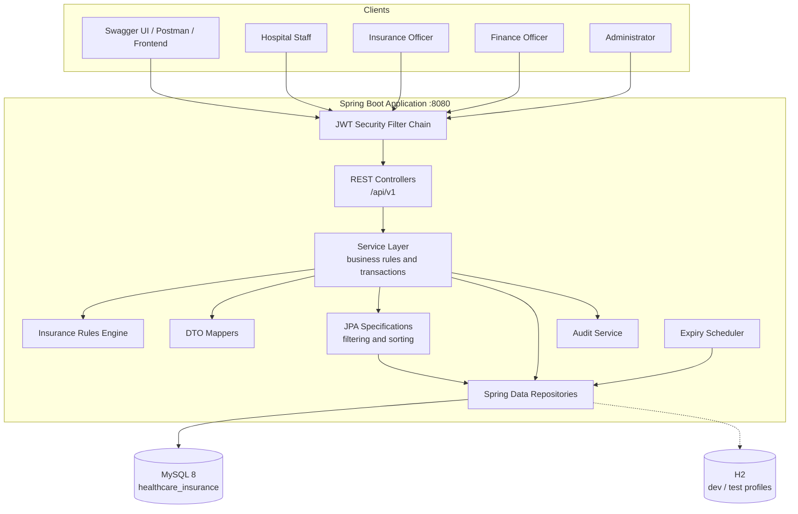
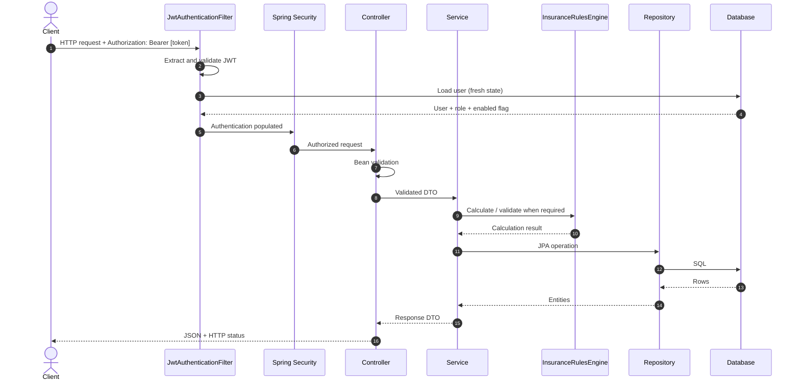
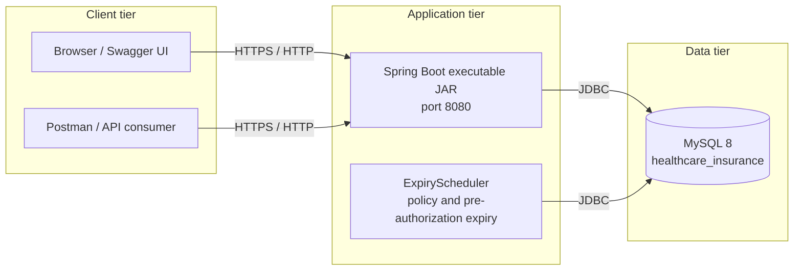
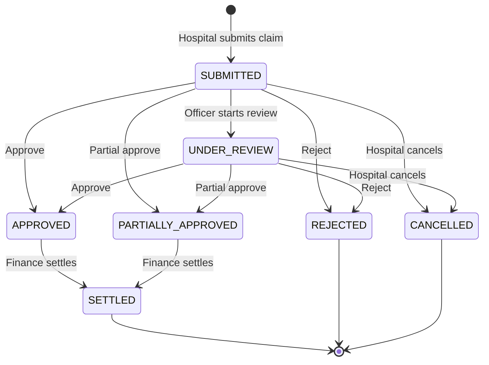
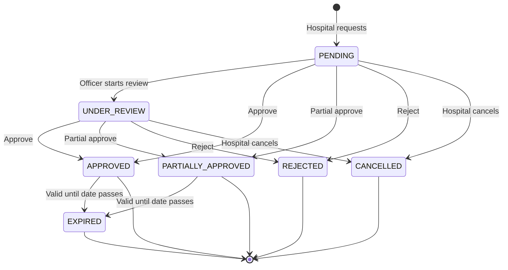
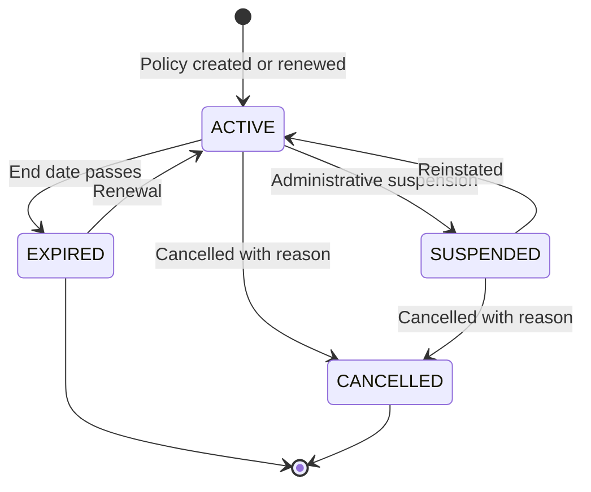

# Healthcare Insurance Claim & Pre-Authorization Management System

**Build:** Maven Wrapper (Maven 3.9.16) · **Language:** Java 17 · **Framework:** Spring Boot 4.1.2 · **Database:** MySQL 8 / H2 · **Tests:** 59 / 59 passing · **Last verified:** 11 November 2026

A production-style Spring Boot backend for a healthcare insurance processing platform. Hospitals register patients, verify eligibility, request pre-authorizations, submit claims and track settlements. Insurance officers review and adjudicate claims through a configurable rules engine, while finance officers process payments. Every workflow action is written to an immutable audit trail.

---

## Table of Contents

1. [Overview](#1-overview)
2. [Features](#2-features)
3. [Technology Stack](#3-technology-stack)
4. [System Architecture](#4-system-architecture)
5. [Domain Model and ER Diagram](#5-domain-model-and-er-diagram)
6. [Business Rules](#6-business-rules)
7. [API Reference](#7-api-reference)
8. [Security and Role Matrix](#8-security-and-role-matrix)
9. [Configuration](#9-configuration)
10. [Getting Started](#10-getting-started)
11. [Demo Data and Credentials](#11-demo-data-and-credentials)
12. [Testing](#12-testing)
13. [Postman Collection](#13-postman-collection)
14. [Project Structure](#14-project-structure)
15. [Design Decisions](#15-design-decisions)
16. [Known Limitations and Future Enhancements](#16-known-limitations-and-future-enhancements)
17. [Troubleshooting](#17-troubleshooting)
18. [Documentation](#18-documentation)
19. [License](#19-license)

---

## 1. Overview

The system models the complete health-insurance claim lifecycle:

```text
Policy registration
      |
      v
Eligibility verification
      |
      v
Pre-authorization request --> review --> approve / partially approve / reject
      |
      v
Claim submission --> review --> adjudication --> approval / partial approval / rejection
      |
      v
Settlement --> policy and category utilization updated
      |
      v
Audit trail (every transition)
```

### Project at a glance

| Item | Detail |
|---|---|
| Application type | Stateless REST API |
| Base URL | `http://localhost:8080` |
| API base path | `/api/v1` |
| Authentication | JWT access token + refresh token |
| Authorization | Role-based (`ADMIN`, `HOSPITAL`, `INSURANCE_OFFICER`, `FINANCE_OFFICER`) |
| Default database | MySQL 8 (`healthcare_insurance`) |
| Development database | H2 file database in MySQL compatibility mode |
| Test database | H2 in-memory (`jdbc:h2:mem:healthcare_test`) |
| API documentation | Swagger UI and OpenAPI 3 |
| Build tool | Maven Wrapper |
| Java version | 17 |
| Automated tests | 12 suites, 59 tests, 0 failures, 0 errors, 0 skipped |

---

## 2. Features

### Policy management

- Policy registration, update, renewal, suspension, cancellation and expiry
- Sum insured, utilized amount, deductible, co-payment and waiting period
- Per-category coverage limits with tracked utilization
- Per-category exclusions with reasons
- Optimistic locking with `@Version`

### Eligibility verification

- Policy ownership and status validation
- Policy period and waiting-period validation
- Coverage availability and remaining-limit checks
- Exclusion checks
- Estimated insurer payable and patient responsibility when an estimated cost is supplied

### Pre-authorization

- Request, review, approve, partial approve, reject, cancel and expire
- Approved amount and validity date
- Pre-authorization cap enforcement during adjudication

### Claims

- Claim submission with full validation
- Invoice uniqueness per hospital
- SHA-256 fingerprint duplicate detection
- Review, adjudication preview and adjudication
- Approve, partial approve and reject decisions
- Cancellation guard rails
- Claim activity audit history

### Settlements

- Settlement of approved or partially approved claims
- Pessimistic locking of claim, policy and coverage rows
- Policy and category utilization updates
- Duplicate settlement and duplicate payment-reference protection

### Platform capabilities

- Stateless JWT authentication with access and refresh tokens
- BCrypt password hashing (strength 12)
- Method-level authorization with `@PreAuthorize`
- Pagination, sorting and module-specific filtering on all list endpoints
- Centralized exception handling with a consistent JSON error model
- Bean validation on every request payload
- OpenAPI 3 / Swagger UI documentation
- Scheduled policy and pre-authorization expiry jobs
- Immutable audit trail
- Unit tests with JUnit 5 and Mockito
- HTTP-level integration tests on H2

---

## 3. Technology Stack

| Component | Version / Notes |
|---|---|
| Java | 17 |
| Spring Boot | 4.1.2 |
| Spring Framework | 7.x (Boot managed) |
| Spring Security | 7.1.2 |
| Spring Data JPA / Hibernate | Boot managed |
| MySQL Connector/J | Boot managed |
| JJWT | 0.12.6 |
| springdoc-openapi | 3.2.0 |
| Lombok | Boot managed |
| JUnit 5 / Mockito / AssertJ | Boot managed |
| H2 | Development and test profiles |
| Maven Wrapper | 3.3.4 (Maven 3.9.16) |
| MySQL | 8.x (Docker image 8.4, local runtime 8.0.46) |

---

## 4. System Architecture

### 4.1 High-level architecture



### 4.2 Layered architecture

```text
+-----------------------------------------------------------------------+
|                        Presentation Layer                             |
|  REST Controllers, Bean Validation, @PreAuthorize, OpenAPI annotations |
+-----------------------------------+-----------------------------------+
                                    |
                                    v
+-----------------------------------------------------------------------+
|                         Application Layer                             |
|  Service interfaces and implementations, transactions, orchestration  |
|  AuditService, expiring-workflow state transitions                    |
+-----------------------------------+-----------------------------------+
                                    |
                                    v
+-----------------------------------------------------------------------+
|                           Domain Layer                                |
|  Entities, enums, InsuranceRulesEngine, AdjudicationCalculation       |
|  Business invariants and state-transition guards                      |
+-----------------------------------+-----------------------------------+
                                    |
                                    v
+-----------------------------------------------------------------------+
|                        Infrastructure Layer                           |
|  Spring Data JPA repositories, Criteria specifications, mappers,      |
|  JWT security components, scheduler, configuration                    |
+-----------------------------------+-----------------------------------+
                                    |
                                    v
+-----------------------------------------------------------------------+
|                          Data Layer                                   |
|  MySQL 8 (default) / H2 (dev and test), schema managed by Hibernate   |
+-----------------------------------------------------------------------+
```

The application follows a strict layered architecture:

```text
HTTP Request
    |
    v
Controller (REST, validation, role checks)
    |
    v
Service Interface
    |
    v
Service Implementation (business rules, transactions)
    |
    v
Repository (Spring Data JPA)
    |
    v
MySQL
```

Transaction boundaries are declared on service methods. Read operations use read-only transactions. State transitions and settlements use pessimistic row locks where concurrent updates are possible, with JPA optimistic locking (`@Version`) as an additional safeguard.

### 4.3 Component responsibilities

| Package | Responsibility | Key classes |
|---|---|---|
| `config` | Security, OpenAPI, scheduling, application properties, bootstrap data | `SecurityConfig`, `OpenApiConfig`, `SchedulingConfig`, `DataInitializer`, `DemoDataInitializer`, `AppProperties` |
| `controller` | REST endpoints, validation, role checks | 10 controllers under `/api/v1` |
| `dto` | Request and response records, shared page and error envelopes | `PageResponse`, `ApiError`, module-specific request/response records |
| `entity` | JPA entities, enums and workflow states | 10 domain entities plus `BaseEntity` |
| `repository` | Spring Data JPA repositories and query methods | 10 repositories |
| `service` | Service contracts | 10 service interfaces |
| `service.impl` | Business logic, transactions, state machines | 10 service implementations |
| `rules` | Insurance calculations | `InsuranceRulesEngine`, `AdjudicationCalculation` |
| `mapper` | Entity-to-DTO mapping | 8 mapper classes |
| `specification` | Criteria-based filtering | 8 specification classes |
| `security` | JWT filter, token service, principal, handlers | `JwtService`, `JwtAuthenticationFilter`, `UserPrincipal`, `CustomUserDetailsService`, `JwtAuthenticationEntryPoint`, `JwtAccessDeniedHandler`, `SecurityErrorWriter` |
| `scheduler` | Policy and pre-authorization expiry | `ExpiryScheduler` |
| `util` | Reference numbers, fingerprinting, pagination, security helpers | `ReferenceNumberGenerator`, `ClaimFingerprint`, `PageableUtils`, `SecurityUtils` |
| `exception` | Domain exceptions and global mapping | `GlobalExceptionHandler`, `BusinessRuleException`, `DuplicateResourceException`, `InvalidStatusTransitionException`, `ResourceNotFoundException` |

### 4.4 Request lifecycle



### 4.5 Authentication flow

```mermaid
sequenceDiagram
    autonumber
    actor User
    participant API as AuthController
    participant Manager as AuthenticationManager
    participant Details as CustomUserDetailsService
    participant Jwt as JwtService
    participant DB as Database

    User->>API: POST /api/v1/auth/login
    API->>Manager: authenticate(username, password)
    Manager->>Details: loadUserByUsername
    Details->>DB: Find user
    DB-->>Details: Password hash, role, enabled flag
    Details-->>Manager: UserPrincipal
    Manager->>Manager: BCrypt password check
    Manager-->>API: Authenticated principal
    API->>Jwt: generateTokens(principal)
    Jwt-->>API: Access token + refresh token
    API-->>User: LoginResponse
    User->>API: POST /api/v1/auth/refresh
    API->>Jwt: validate refresh token
    API->>DB: Reload user and enabled state
    API-->>User: New token pair
```

### 4.6 Claim lifecycle

```mermaid
sequenceDiagram
    autonumber
    actor Hospital
    actor Officer as Insurance Officer
    actor Finance as Finance Officer
    participant API as Claim / Settlement API
    participant Rules as InsuranceRulesEngine
    participant DB as Database
    participant Audit as Audit Service

    Hospital->>API: POST /claims
    API->>DB: Save claim (SUBMITTED)
    API->>Audit: CLAIM_SUBMITTED
    Officer->>API: POST /claims/{id}/review
    API->>DB: UNDER_REVIEW
    Officer->>API: GET /claims/{id}/adjudication-preview
    API->>Rules: Preview calculation
    Rules-->>API: Eligible, deductible, co-pay, approved, patient share
    Officer->>API: POST /claims/{id}/adjudicate
    API->>Rules: Final calculation and guards
    API->>DB: APPROVED / PARTIALLY_APPROVED / REJECTED
    API->>Audit: CLAIM_ADJUDICATED
    Finance->>API: POST /settlements
    API->>DB: Lock claim, policy, coverage; save settlement
    API->>DB: Increase policy and category utilization
    API->>Audit: CLAIM_SETTLED
    API-->>Finance: PROCESSED settlement
```

### 4.7 Deployment topology



For local development the data tier can be replaced by H2 in MySQL compatibility mode without changing the application code.

### 4.8 Cross-cutting concerns

| Concern | Implementation |
|---|---|
| Authentication | Stateless JWT filter; user reloaded from database on every request |
| Authorization | `@PreAuthorize` on controller methods; role matrix in section 8 |
| Validation | Jakarta Bean Validation on DTO records; business validation in services |
| Error handling | `GlobalExceptionHandler` maps domain exceptions to a stable JSON model |
| Transactions | Declared on service methods; read-only for queries |
| Concurrency | Pessimistic locks for settlement; `@Version` optimistic locking on policy, coverage, claim, pre-authorization and settlement |
| Audit | Append-only audit entries written by `AuditServiceImpl` |
| Scheduling | `ExpiryScheduler` updates expired policies and pre-authorizations |
| API documentation | springdoc-openapi with bearer authentication scheme |
| Pagination | Shared `PageResponse`; sort fields sanitized against an allowlist |

---

## 5. Domain Model and ER Diagram

### 5.1 ER diagram

```mermaid
erDiagram
    USERS {
        bigint id PK
        varchar username UK
        varchar email UK
        varchar password
        varchar full_name
        varchar role
        boolean enabled
        datetime created_at
        datetime updated_at
    }

    HOSPITALS {
        bigint id PK
        varchar hospital_code UK
        varchar name
        varchar license_number UK
        varchar email
        varchar phone
        varchar address
        varchar contact_person
        boolean active
        datetime created_at
        datetime updated_at
    }

    PATIENTS {
        bigint id PK
        varchar patient_code UK
        varchar first_name
        varchar last_name
        date date_of_birth
        varchar gender
        varchar email
        varchar phone
        varchar address
        boolean active
        datetime created_at
        datetime updated_at
    }

    INSURANCE_POLICIES {
        bigint id PK
        varchar policy_number UK
        bigint patient_id FK
        varchar provider_name
        varchar policy_type
        varchar status
        date start_date
        date end_date
        decimal sum_insured
        decimal utilized_amount
        decimal deductible_amount
        decimal co_payment_percentage
        int waiting_period_days
        decimal premium_amount
        int renewal_count
        datetime last_renewed_at
        varchar cancellation_reason
        bigint version
        datetime created_at
        datetime updated_at
    }

    POLICY_COVERAGES {
        bigint id PK
        bigint policy_id FK
        varchar coverage_type
        decimal coverage_limit
        decimal utilized_amount
        boolean active
        bigint version
        datetime created_at
        datetime updated_at
    }

    POLICY_EXCLUSIONS {
        bigint id PK
        bigint policy_id FK
        varchar treatment_category
        varchar reason
        datetime created_at
        datetime updated_at
    }

    PRE_AUTHORIZATIONS {
        bigint id PK
        varchar reference_number UK
        bigint patient_id FK
        bigint policy_id FK
        bigint hospital_id FK
        varchar treating_doctor
        varchar diagnosis_code
        varchar procedure_code
        varchar treatment_category
        varchar treatment_description
        decimal estimated_cost
        date requested_date
        varchar status
        decimal approved_amount
        date valid_until
        varchar remarks
        bigint requested_by FK
        bigint reviewed_by FK
        datetime decision_date
        bigint version
        datetime created_at
        datetime updated_at
    }

    CLAIMS {
        bigint id PK
        varchar claim_number UK
        varchar claim_fingerprint UK
        bigint patient_id FK
        bigint policy_id FK
        bigint hospital_id FK
        bigint pre_authorization_id FK
        varchar treating_doctor
        varchar diagnosis_code
        varchar procedure_code
        varchar treatment_category
        date admission_date
        date discharge_date
        date claim_date
        decimal claimed_amount
        varchar invoice_number
        varchar description
        varchar status
        decimal deductible_applied
        decimal co_payment_amount
        decimal non_covered_amount
        decimal approved_amount
        decimal patient_responsibility
        varchar rejection_reason
        varchar adjudication_notes
        bigint submitted_by FK
        bigint reviewed_by FK
        bigint adjudicated_by FK
        datetime reviewed_at
        datetime adjudicated_at
        bigint version
        datetime created_at
        datetime updated_at
    }

    CLAIM_SETTLEMENTS {
        bigint id PK
        varchar settlement_number UK
        bigint claim_id FK, UK
        decimal approved_amount
        decimal paid_amount
        decimal patient_responsibility
        varchar payment_mode
        varchar payment_reference UK
        varchar status
        bigint processed_by FK
        datetime processed_at
        varchar remarks
        bigint version
        datetime created_at
        datetime updated_at
    }

    AUDIT_LOGS {
        bigint id PK
        bigint claim_id FK
        varchar entity_type
        bigint entity_id
        varchar action
        bigint performed_by FK
        varchar details
        datetime created_at
        datetime updated_at
    }

    PATIENTS ||--o{ INSURANCE_POLICIES : holds
    INSURANCE_POLICIES ||--o{ POLICY_COVERAGES : defines
    INSURANCE_POLICIES ||--o{ POLICY_EXCLUSIONS : defines
    PATIENTS ||--o{ PRE_AUTHORIZATIONS : requests
    INSURANCE_POLICIES ||--o{ PRE_AUTHORIZATIONS : covers
    HOSPITALS ||--o{ PRE_AUTHORIZATIONS : submits
    USERS ||--o{ PRE_AUTHORIZATIONS : requested_by
    USERS ||--o{ PRE_AUTHORIZATIONS : reviewed_by
    PATIENTS ||--o{ CLAIMS : submits
    INSURANCE_POLICIES ||--o{ CLAIMS : validates
    HOSPITALS ||--o{ CLAIMS : files
    PRE_AUTHORIZATIONS |o--o{ CLAIMS : authorizes
    USERS ||--o{ CLAIMS : submitted_by
    USERS ||--o{ CLAIMS : reviewed_by
    USERS ||--o{ CLAIMS : adjudicated_by
    CLAIMS ||--o| CLAIM_SETTLEMENTS : settles
    USERS ||--o{ CLAIM_SETTLEMENTS : processed_by
    CLAIMS ||--o{ AUDIT_LOGS : records
    USERS ||--o{ AUDIT_LOGS : performed_by
```



### 5.2 Entity summary

| Entity | Table | Purpose |
|---|---|---|
| `User` | `users` | System actor with a role and enabled flag |
| `Hospital` | `hospitals` | Registered hospital that files claims and pre-authorizations |
| `Patient` | `patients` | Insurance member |
| `InsurancePolicy` | `insurance_policies` | Policy period, sum insured, utilization, deductible, co-payment and waiting period |
| `PolicyCoverage` | `policy_coverages` | Per-category coverage limit and utilization |
| `PolicyExclusion` | `policy_exclusions` | Treatment categories excluded from a policy |
| `PreAuthorization` | `pre_authorizations` | Treatment approval request and decision |
| `Claim` | `claims` | Medical claim, adjudication result and workflow state |
| `ClaimSettlement` | `claim_settlements` | Payment record for an approved claim |
| `AuditLog` | `audit_logs` | Immutable activity record linked optionally to a claim |

All entities extend `BaseEntity`, which supplies `id`, `created_at` and `updated_at`.

### 5.3 Relationship summary

| Parent | Child | Cardinality | Key | Notes |
|---|---|---|---|---|
| `patients` | `insurance_policies` | 1 : N | `patient_id` | A patient can hold multiple policies over time |
| `insurance_policies` | `policy_coverages` | 1 : N | `policy_id` | One row per treatment category |
| `insurance_policies` | `policy_exclusions` | 1 : N | `policy_id` | One row per excluded treatment category |
| `patients` | `pre_authorizations` | 1 : N | `patient_id` | Requests are tied to a single patient |
| `insurance_policies` | `pre_authorizations` | 1 : N | `policy_id` | Approval is limited by policy and category limits |
| `hospitals` | `pre_authorizations` | 1 : N | `hospital_id` | Requesting hospital |
| `users` | `pre_authorizations` | 1 : N | `requested_by`, `reviewed_by` | Workflow actors |
| `patients` | `claims` | 1 : N | `patient_id` | Claim holder |
| `insurance_policies` | `claims` | 1 : N | `policy_id` | Claim must match the patient policy |
| `hospitals` | `claims` | 1 : N | `hospital_id` | Claim filing hospital |
| `pre_authorizations` | `claims` | 1 : 0..N | `pre_authorization_id` | Optional link to the approving pre-authorization |
| `users` | `claims` | 1 : N | `submitted_by`, `reviewed_by`, `adjudicated_by` | Workflow actors |
| `claims` | `claim_settlements` | 1 : 1 | `claim_id` | A claim can be settled at most once |
| `claims` | `audit_logs` | 1 : N | `claim_id` | Claim activity history |
| `users` | `audit_logs` | 1 : N | `performed_by` | Acting user |

### 5.4 Uniqueness constraints

| Constraint | Columns | Purpose |
|---|---|---|
| `uk_claims_fingerprint` | `claim_fingerprint` | Duplicate claim detection across all submissions |
| `uk_claims_hospital_invoice` | `hospital_id`, `invoice_number` | Prevent reusing an invoice number at the same hospital |
| `uk_policy_coverage_type` | `policy_id`, `coverage_type` | One coverage row per treatment category |
| `uk_policy_exclusion_type` | `policy_id`, `treatment_category` | One exclusion row per treatment category |
| `uk_settlements_claim` | `claim_id` | Single settlement per claim |
| `uk_settlements_reference` | `payment_reference` | Prevent duplicate payment references |
| `uk_preauth_reference` | `reference_number` | Unique business reference |
| `uk_claims_number` | `claim_number` | Unique business reference |

### 5.5 Enumerations

| Enum | Values |
|---|---|
| `Role` | `ADMIN`, `HOSPITAL`, `INSURANCE_OFFICER`, `FINANCE_OFFICER` |
| `Gender` | `MALE`, `FEMALE`, `OTHER` |
| `PolicyType` | `INDIVIDUAL`, `FAMILY`, `GROUP` |
| `PolicyStatus` | `ACTIVE`, `EXPIRED`, `SUSPENDED`, `CANCELLED` |
| `TreatmentCategory` | `CONSULTATION`, `HOSPITALIZATION`, `SURGERY`, `MEDICATION`, `DIAGNOSTIC`, `MATERNITY`, `DENTAL`, `VISION`, `EMERGENCY` |
| `PreAuthorizationStatus` | `PENDING`, `UNDER_REVIEW`, `APPROVED`, `PARTIALLY_APPROVED`, `REJECTED`, `EXPIRED`, `CANCELLED` |
| `PreAuthorizationDecision` | `APPROVE`, `PARTIAL_APPROVE`, `REJECT` |
| `ClaimStatus` | `SUBMITTED`, `UNDER_REVIEW`, `APPROVED`, `PARTIALLY_APPROVED`, `REJECTED`, `SETTLED`, `CANCELLED` |
| `AdjudicationDecision` | `APPROVE`, `PARTIAL_APPROVE`, `REJECT` |
| `SettlementStatus` | `PROCESSED`, `FAILED` |
| `PaymentMode` | `BANK_TRANSFER`, `CHEQUE`, `UPI`, `CARD` |
| `AuditEntityType` | `USER`, `HOSPITAL`, `PATIENT`, `POLICY`, `PRE_AUTHORIZATION`, `CLAIM`, `SETTLEMENT` |
| `AuditAction` | `USER_REGISTERED`, `USER_STATUS_CHANGED`, `HOSPITAL_CREATED`, `HOSPITAL_UPDATED`, `PATIENT_CREATED`, `PATIENT_UPDATED`, `POLICY_CREATED`, `POLICY_UPDATED`, `POLICY_RENEWED`, `POLICY_STATUS_CHANGED`, `COVERAGE_ADDED`, `COVERAGE_UPDATED`, `EXCLUSION_ADDED`, `EXCLUSION_REMOVED`, `ELIGIBILITY_VERIFIED`, `PRE_AUTHORIZATION_REQUESTED`, `PRE_AUTHORIZATION_REVIEWED`, `PRE_AUTHORIZATION_DECIDED`, `PRE_AUTHORIZATION_CANCELLED`, `CLAIM_SUBMITTED`, `CLAIM_REVIEWED`, `CLAIM_ADJUDICATED`, `CLAIM_CANCELLED`, `CLAIM_SETTLED` |

### 5.6 State machines

#### Claim



#### Pre-authorization



#### Policy



---

## 6. Business Rules

### 6.1 Eligibility

A patient is eligible when all of the following hold:

- The policy belongs to the patient and is `ACTIVE`
- The patient is active
- The service date falls inside the policy period
- The service date is after the waiting period (`startDate + waitingPeriodDays`)
- An active coverage exists for the treatment category
- The policy and category remaining amounts are greater than zero
- The treatment category is not excluded

When an estimated cost is supplied, the eligibility response also returns an estimated insurer payable amount and patient responsibility using the same rules engine as adjudication.

### 6.2 Insurance rules engine

The calculation order is:

1. Claimed amount is normalized to two decimals
2. Policy status, policy period, waiting period, exclusions and coverage availability are validated
3. Eligible amount is capped by remaining policy coverage, remaining category coverage and any pre-authorization limit
4. Deductible is applied to the eligible amount
5. Co-payment percentage is applied to the amount after the deductible
6. Approved amount is the amount after deductible and co-payment
7. Patient responsibility is the claimed amount minus the approved amount

Formula:

```text
eligible        = min(claimed, policyRemaining, categoryRemaining, preAuthLimit)
deductible      = min(policyDeductible, eligible)
afterDeductible = eligible - deductible
coPayment       = afterDeductible x coPaymentPercentage / 100
approved        = afterDeductible - coPayment
patientShare    = claimed - approved
```

### 6.3 Duplicate claim detection

Two independent safeguards are applied:

1. **Business check:** a SHA-256 fingerprint is generated from patient, policy, hospital, procedure code, admission date, discharge date and claimed amount. An existing fingerprint returns HTTP 409.
2. **Database guarantee:** the fingerprint has a unique constraint. Invoice numbers are also unique per hospital. If a concurrent request passes the business check, the unique constraint rejects the insert and the service converts the integrity violation into HTTP 409.

### 6.4 Claim workflow

```text
SUBMITTED -> UNDER_REVIEW -> APPROVED | PARTIALLY_APPROVED | REJECTED
SUBMITTED | UNDER_REVIEW -> CANCELLED
APPROVED | PARTIALLY_APPROVED -> SETTLED
```

Claims can be adjudicated from `SUBMITTED` or `UNDER_REVIEW`. A pre-authorization linked to a claim must be approved or partially approved, must belong to the same patient, policy, hospital and treatment category, and must be valid for the admission date. Its approved amount becomes an upper bound for claim payment.

### 6.5 Pre-authorization rules

- Only hospitals can request or cancel a pre-authorization
- Only insurance officers can review or decide a pre-authorization
- A decision can be recorded only once
- `PARTIAL_APPROVE` requires an approved amount strictly below the estimated cost
- `REJECT` requires remarks
- When `APPROVE` is recorded without an amount, the estimated cost is used
- A validity date can be supplied; expired approvals are moved to `EXPIRED` by the scheduler

### 6.6 Settlement rules

- Only `APPROVED` or `PARTIALLY_APPROVED` claims can be settled
- A claim can be settled only once
- Payment references are unique
- The claim, policy and coverage rows are locked pessimistically
- Policy and category utilization are increased by the approved amount at settlement time
- A settlement fails if the remaining policy or category coverage is insufficient

---

## 7. API Reference

### 7.1 Conventions

- Base path: `/api/v1`
- Content type: `application/json`
- Authentication header: `Authorization: Bearer <accessToken>`
- All timestamps are ISO-8601 UTC
- All list endpoints return the shared page envelope

### 7.2 Authentication

| Method | Endpoint | Access | Purpose |
|---|---|---|---|
| `POST` | `/auth/login` | Public | Authenticate and receive access and refresh tokens |
| `POST` | `/auth/refresh` | Public | Exchange a refresh token for a new token pair |
| `GET` | `/auth/me` | Authenticated | Return the current user profile |
| `POST` | `/auth/register` | `ADMIN` | Register a new user with a role |

### 7.3 Endpoint matrix

| Module | Method | Endpoint | Allowed roles |
|---|---|---|---|
| Auth | `POST` | `/auth/login` | Public |
| Auth | `POST` | `/auth/refresh` | Public |
| Auth | `GET` | `/auth/me` | Authenticated |
| Auth | `POST` | `/auth/register` | `ADMIN` |
| Users | `GET` | `/users` | `ADMIN` |
| Users | `PATCH` | `/users/{id}/status` | `ADMIN` |
| Hospitals | `POST` | `/hospitals` | `ADMIN` |
| Hospitals | `PUT` | `/hospitals/{id}` | `ADMIN` |
| Hospitals | `GET` | `/hospitals/{id}` | All roles |
| Hospitals | `GET` | `/hospitals` | All roles |
| Patients | `POST` | `/patients` | `ADMIN`, `HOSPITAL` |
| Patients | `PUT` | `/patients/{id}` | `ADMIN`, `HOSPITAL` |
| Patients | `GET` | `/patients/{id}` | All roles |
| Patients | `GET` | `/patients` | All roles |
| Policies | `POST` | `/policies` | `ADMIN`, `INSURANCE_OFFICER` |
| Policies | `PUT` | `/policies/{id}` | `ADMIN`, `INSURANCE_OFFICER` |
| Policies | `GET` | `/policies/{id}` | All roles |
| Policies | `GET` | `/policies` | All roles |
| Policies | `POST` | `/policies/{id}/renew` | `ADMIN`, `INSURANCE_OFFICER` |
| Policies | `PATCH` | `/policies/{id}/status` | `ADMIN`, `INSURANCE_OFFICER` |
| Coverages | `POST` | `/policies/{id}/coverages` | `ADMIN`, `INSURANCE_OFFICER` |
| Coverages | `PUT` | `/policies/{id}/coverages/{coverageId}` | `ADMIN`, `INSURANCE_OFFICER` |
| Coverages | `GET` | `/policies/{id}/coverages` | All roles |
| Exclusions | `POST` | `/policies/{id}/exclusions` | `ADMIN`, `INSURANCE_OFFICER` |
| Exclusions | `GET` | `/policies/{id}/exclusions` | All roles |
| Exclusions | `DELETE` | `/policies/{id}/exclusions/{exclusionId}` | `ADMIN`, `INSURANCE_OFFICER` |
| Eligibility | `POST` | `/eligibility/verify` | All roles |
| Pre-authorization | `POST` | `/pre-authorizations` | `HOSPITAL` |
| Pre-authorization | `GET` | `/pre-authorizations/{id}` | All roles |
| Pre-authorization | `GET` | `/pre-authorizations` | All roles |
| Pre-authorization | `POST` | `/pre-authorizations/{id}/review` | `INSURANCE_OFFICER` |
| Pre-authorization | `POST` | `/pre-authorizations/{id}/decision` | `INSURANCE_OFFICER` |
| Pre-authorization | `POST` | `/pre-authorizations/{id}/cancel` | `HOSPITAL` |
| Claims | `POST` | `/claims` | `HOSPITAL` |
| Claims | `GET` | `/claims/{id}` | All roles |
| Claims | `GET` | `/claims` | All roles |
| Claims | `POST` | `/claims/{id}/review` | `INSURANCE_OFFICER` |
| Claims | `GET` | `/claims/{id}/adjudication-preview` | `INSURANCE_OFFICER` |
| Claims | `POST` | `/claims/{id}/adjudicate` | `INSURANCE_OFFICER` |
| Claims | `POST` | `/claims/{id}/cancel` | `HOSPITAL` |
| Claims | `GET` | `/claims/{id}/audit` | All roles |
| Settlements | `POST` | `/settlements` | `FINANCE_OFFICER` |
| Settlements | `GET` | `/settlements/{id}` | `ADMIN`, `FINANCE_OFFICER` |
| Settlements | `GET` | `/settlements` | `ADMIN`, `FINANCE_OFFICER` |
| Audits | `GET` | `/audits` | `ADMIN` |
| Audits | `GET` | `/audits/{id}` | `ADMIN` |

### 7.4 Pagination, sorting and filtering

All list endpoints accept:

| Parameter | Default | Description |
|---|---|---|
| `page` | `0` | Zero-based page number |
| `size` | `20` | Page size, capped at `100` |
| `sort` | Module default | `field,direction`, for example `sort=createdAt,desc` |

Module-specific filters:

| Module | Filters |
|---|---|
| Users | `role`, `enabled`, `search` |
| Hospitals | `active`, `search` |
| Patients | `active`, `search` |
| Policies | `patientId`, `status`, `policyType`, `policyNumber`, `providerName`, `expiringBefore` |
| Pre-authorizations | `status`, `patientId`, `hospitalId`, `policyNumber`, `referenceNumber`, `treatmentCategory`, `fromDate`, `toDate` |
| Claims | `status`, `patientId`, `hospitalId`, `policyNumber`, `claimNumber`, `treatmentCategory`, `fromDate`, `toDate` |
| Settlements | `status`, `claimId`, `claimNumber`, `fromDate`, `toDate` |
| Audits | `claimId`, `entityType`, `action`, `fromDate`, `toDate` |

Unknown sort fields are ignored and replaced by the module default. Responses use a stable page envelope:

```json
{
  "content": [],
  "page": 0,
  "size": 20,
  "totalElements": 0,
  "totalPages": 0,
  "first": true,
  "last": true
}
```

### 7.5 Error model

```json
{
  "timestamp": "2026-11-05T10:15:30Z",
  "status": 422,
  "error": "Unprocessable Entity",
  "message": "Insufficient policy coverage remaining for settlement",
  "path": "/api/v1/settlements",
  "details": []
}
```

| Status | Meaning |
|---|---|
| `400` | Validation failure or malformed request |
| `401` | Missing, invalid or expired credentials |
| `403` | Authenticated but not authorized |
| `404` | Resource not found |
| `409` | Duplicate resource, duplicate claim or invalid state transition |
| `422` | Business rule violation |
| `500` | Unexpected server error |

### 7.6 Sample requests with verified demo values

The payloads below match the demo dataset described in section 11. Replace IDs with values returned by the corresponding list endpoints when running against an existing database.

#### Login

```bash
curl -X POST http://localhost:8080/api/v1/auth/login \
  -H "Content-Type: application/json" \
  -d "{\"username\":\"admin\",\"password\":\"Admin@12345\"}"
```

```json
{
  "username": "admin",
  "password": "Admin@12345"
}
```

Use the returned `accessToken` in Swagger UI's **Authorize** dialog. Paste the raw token; Swagger adds the `Bearer ` prefix.

#### Register an operational user (ADMIN)

```json
{
  "username": "hospital1",
  "email": "hospital1@healthcare.com",
  "password": "Demo@12345",
  "fullName": "City General Hospital",
  "role": "HOSPITAL"
}
```

#### Create a hospital (ADMIN)

```json
{
  "hospitalCode": "HSP-001",
  "name": "City General Hospital",
  "licenseNumber": "LIC-HSP-001",
  "email": "contact@citygeneral.example",
  "phone": "+91-9876543210",
  "address": "12 Health Avenue, Bengaluru",
  "contactPerson": "Ravi Kumar",
  "active": true
}
```

#### Create a patient (ADMIN or HOSPITAL)

```json
{
  "firstName": "John",
  "lastName": "Doe",
  "dateOfBirth": "1985-06-15",
  "gender": "MALE",
  "email": "john.doe@example.com",
  "phone": "+91-9876501234",
  "address": "45 Lake Road, Bengaluru",
  "active": true
}
```

#### Create a policy (ADMIN or INSURANCE_OFFICER)

```json
{
  "patientId": 1,
  "providerName": "SecureLife Insurance",
  "policyType": "INDIVIDUAL",
  "startDate": "2026-01-01",
  "endDate": "2026-12-31",
  "sumInsured": 500000.00,
  "deductibleAmount": 5000.00,
  "coPaymentPercentage": 10.00,
  "waitingPeriodDays": 30,
  "premiumAmount": 25000.00
}
```

The policy number is generated when omitted.

#### Add coverage (ADMIN or INSURANCE_OFFICER)

```json
{
  "coverageType": "HOSPITALIZATION",
  "coverageLimit": 300000.00,
  "active": true
}
```

#### Add an exclusion (ADMIN or INSURANCE_OFFICER)

```json
{
  "treatmentCategory": "DENTAL",
  "reason": "Dental treatment is not covered under this policy"
}
```

#### Renew a policy (ADMIN or INSURANCE_OFFICER)

```json
{
  "newEndDate": "2027-12-31",
  "additionalSumInsured": 100000.00,
  "premiumAmount": 27000.00
}
```

#### Change policy status (ADMIN or INSURANCE_OFFICER)

```json
{
  "status": "SUSPENDED",
  "reason": "Premium payment pending"
}
```

#### Verify eligibility (all roles)

```json
{
  "patientId": 1,
  "policyNumber": "POL-2026-000001",
  "treatmentCategory": "HOSPITALIZATION",
  "estimatedCost": 100000.00,
  "serviceDate": "2026-11-05"
}
```

#### Request a pre-authorization (HOSPITAL)

```json
{
  "patientId": 1,
  "policyId": 1,
  "hospitalId": 1,
  "treatingDoctor": "Dr. Meera Rao",
  "diagnosisCode": "K35.80",
  "procedureCode": "APPY-001",
  "treatmentCategory": "SURGERY",
  "treatmentDescription": "Laparoscopic appendectomy",
  "estimatedCost": 120000.00,
  "requestedDate": "2026-11-01"
}
```

#### Review a pre-authorization (INSURANCE_OFFICER)

No request body:

```text
POST /api/v1/pre-authorizations/{id}/review
```

#### Decide a pre-authorization (INSURANCE_OFFICER)

```json
{
  "decision": "APPROVE",
  "approvedAmount": 120000.00,
  "remarks": "Approved as per policy coverage",
  "validUntil": "2026-12-31"
}
```

#### Submit a claim (HOSPITAL)

```json
{
  "patientId": 1,
  "policyId": 1,
  "hospitalId": 1,
  "preAuthorizationId": 1,
  "treatingDoctor": "Dr. Meera Rao",
  "diagnosisCode": "K35.80",
  "procedureCode": "APPY-001",
  "treatmentCategory": "SURGERY",
  "admissionDate": "2026-11-03",
  "dischargeDate": "2026-11-05",
  "claimDate": "2026-11-06",
  "claimedAmount": 120000.00,
  "invoiceNumber": "INV-2026-0001",
  "description": "Laparoscopic appendectomy with two-day stay"
}
```

#### Review a claim (INSURANCE_OFFICER)

No request body:

```text
POST /api/v1/claims/{id}/review
```

#### Preview adjudication (INSURANCE_OFFICER)

```text
GET /api/v1/claims/{id}/adjudication-preview
```

#### Adjudicate a claim (INSURANCE_OFFICER)

```json
{
  "decision": "APPROVE",
  "approvedAmount": 108000.00,
  "rejectionReason": null,
  "notes": "Approved after deductible and co-payment"
}
```

#### Settle a claim (FINANCE_OFFICER)

```json
{
  "claimId": 1,
  "paymentMode": "BANK_TRANSFER",
  "paymentReference": "PAY-2026-0001",
  "remarks": "Settled in full"
}
```

#### Enable or disable a user (ADMIN)

```json
{
  "enabled": false
}
```

#### Read the audit trail

```text
GET /api/v1/claims/{id}/audit
GET /api/v1/audits?entityType=CLAIM&action=CLAIM_ADJUDICATED&page=0&size=20
GET /api/v1/audits/{id}
```

### 7.7 Swagger UI

- Swagger UI: `http://localhost:8080/swagger-ui.html`
- OpenAPI JSON: `http://localhost:8080/v3/api-docs`

Steps:

1. Log in through `POST /api/v1/auth/login`.
2. Copy the `accessToken` value.
3. Click **Authorize** and paste the raw token (without `Bearer `).
4. Use the `page`, `size` and `sort` query parameters directly; the generated `pageable` object is ignored by Spring.

### 7.8 Reference number formats

| Entity | Prefix | Example |
|---|---|---|
| Hospital | `HSP` | `HSP-20261105-AB12CD34` |
| Patient | `PAT` | `PAT-20261105-EF56GH78` |
| Policy | `POL` | `POL-20261105-IJ90KL12` |
| Pre-authorization | `PA` | `PA-20261105-MN34OP56` |
| Claim | `CLM` | `CLM-20261105-QR78ST90` |
| Settlement | `STL` | `STL-20261105-UV12WX34` |

The generator uses the current date in `BASIC_ISO_DATE` format and an eight-character uppercase UUID fragment.

---

## 8. Security and Role Matrix

### 8.1 Authentication design

- Stateless JWT authentication; CSRF disabled
- Access tokens carry subject, user id, role and token type
- Refresh tokens are accepted only by `/auth/refresh`
- Passwords are hashed with BCrypt strength 12
- The JWT filter reloads the user from the database on every request, so disabling an account takes effect immediately
- Method-level authorization with `@PreAuthorize`
- Swagger UI and OpenAPI documents are public; every other endpoint requires authentication
- Bootstrap administrator is created from configuration on first startup
- Users cannot disable their own account

### 8.2 Role matrix

| Capability | ADMIN | HOSPITAL | INSURANCE_OFFICER | FINANCE_OFFICER |
|---|---|---|---|---|
| Manage users | Yes | No | No | No |
| Manage hospitals | Yes | Read | Read | Read |
| Manage patients | Yes | Yes | Read | Read |
| Manage policies and coverages | Yes | Read | Yes | Read |
| Verify eligibility | Yes | Yes | Yes | Yes |
| Request/cancel pre-authorization | No | Yes | No | No |
| Review/decide pre-authorization | No | No | Yes | No |
| Submit/cancel claim | No | Yes | No | No |
| Review/adjudicate claim | No | No | Yes | No |
| Settle claim | No | No | No | Yes |
| View audit records | Yes | Claim history | Claim history | Claim history |

### 8.3 Security controls

| Control | Implementation |
|---|---|
| Password storage | BCrypt strength 12 |
| Token signing | HMAC-SHA with configurable secret (minimum 32 characters) |
| Token types | `access` and `refresh` claims; refresh rejected as access token and vice versa |
| Account state | Reloaded on every request; disabled users are rejected immediately |
| Self-protection | Administrators cannot disable their own account |
| Error responses | Consistent JSON for `401` and `403` through `JwtAuthenticationEntryPoint`, `JwtAccessDeniedHandler` and `SecurityErrorWriter` |
| CORS | Configurable allowed origins; credentials disabled |
| Authorization | Method-level `@PreAuthorize` plus URL-level authentication |

---

## 9. Configuration

### 9.1 Application properties

| Property | Default | Description |
|---|---|---|
| `server.port` | `8080` | HTTP port |
| `spring.datasource.url` | MySQL localhost URL | JDBC URL |
| `spring.datasource.username` | `root` | Database user |
| `spring.datasource.password` | Set locally in `application.properties` | Database password; override with `DB_PASSWORD` |
| `spring.jpa.hibernate.ddl-auto` | `update` | Schema strategy |
| `spring.jpa.open-in-view` | `false` | Disable open-session-in-view |
| `spring.jpa.show-sql` | `false` | SQL logging |
| `spring.data.web.pageable.default-page-size` | `20` | Default page size |
| `spring.data.web.pageable.max-page-size` | `100` | Maximum page size |
| `app.jwt.secret` | Development secret | HMAC signing key |
| `app.jwt.issuer` | `healthcare-insurance-system` | JWT issuer |
| `app.jwt.access-token-expiration-minutes` | `60` | Access token lifetime |
| `app.jwt.refresh-token-expiration-days` | `7` | Refresh token lifetime |
| `app.cors.allowed-origins` | `http://localhost:3000,http://localhost:8080` | Allowed origins |
| `app.bootstrap-admin.username` | `admin` | Bootstrap administrator username |
| `app.bootstrap-admin.email` | `admin@healthcare.com` | Bootstrap administrator email |
| `app.bootstrap-admin.password` | `Admin@12345` | Bootstrap administrator password |
| `app.bootstrap-admin.full-name` | `System Administrator` | Bootstrap administrator display name |
| `app.demo-data.enabled` | `false` | Enable demo data initializer |
| `app.scheduling.enabled` | `true` | Enable scheduled expiry jobs |

### 9.2 Environment variables

| Variable | Maps to |
|---|---|
| `SERVER_PORT` | `server.port` |
| `DB_URL` | `spring.datasource.url` |
| `DB_USERNAME` | `spring.datasource.username` |
| `DB_PASSWORD` | `spring.datasource.password` |
| `DDL_AUTO` | `spring.jpa.hibernate.ddl-auto` |
| `JWT_SECRET` | `app.jwt.secret` |
| `JWT_ACCESS_EXPIRATION_MINUTES` | `app.jwt.access-token-expiration-minutes` |
| `JWT_REFRESH_EXPIRATION_DAYS` | `app.jwt.refresh-token-expiration-days` |
| `CORS_ALLOWED_ORIGINS` | `app.cors.allowed-origins` |
| `ADMIN_USERNAME` | `app.bootstrap-admin.username` |
| `ADMIN_EMAIL` | `app.bootstrap-admin.email` |
| `ADMIN_PASSWORD` | `app.bootstrap-admin.password` |
| `ADMIN_FULL_NAME` | `app.bootstrap-admin.full-name` |
| `DEMO_DATA_ENABLED` | `app.demo-data.enabled` |
| `SCHEDULING_ENABLED` | `app.scheduling.enabled` |

Production deployments must override `JWT_SECRET` and the bootstrap administrator password.

### 9.3 Profiles

| Profile | Datasource | Demo data | Purpose |
|---|---|---|---|
| default | MySQL `healthcare_insurance` | Disabled | Production-style local run |
| `dev` | H2 file `./data/healthcare_dev` | Enabled | Quick start without MySQL |
| `test` | H2 memory `healthcare_test` | Disabled | Automated tests |

The test profile properties live in `src/test/resources/application-test.properties` and use `ddl-auto=create-drop`. Tests never touch the MySQL demo database.

---

## 10. Getting Started

### 10.1 Prerequisites

- JDK 17
- MySQL 8.x for the default profile, or Docker
- No local Maven installation required; the Maven wrapper is included

### 10.2 Option A: H2 development profile (no MySQL)

```powershell
.\mvnw.cmd spring-boot:run -Dspring-boot.run.profiles=dev
```

```bash
./mvnw spring-boot:run -Dspring-boot.run.profiles=dev
```

In IntelliJ, select the shared run configuration **Healthcare Insurance System (H2 dev)**. The database is stored in `data/healthcare_dev.mv.db` and is created on first run. Demo data is enabled automatically.

### 10.3 Option B: local MySQL

1. Create the database:

```sql
CREATE DATABASE healthcare_insurance CHARACTER SET utf8mb4 COLLATE utf8mb4_unicode_ci;
```

The default JDBC URL includes `createDatabaseIfNotExist=true`, so a user with DDL privileges can create the schema on startup.

2. Run the application:

```powershell
.\mvnw.cmd spring-boot:run
```

Override credentials when needed:

```powershell
$env:DB_USERNAME = "healthcare"
$env:DB_PASSWORD = "healthcare123"
.\mvnw.cmd spring-boot:run
```

### 10.4 Option C: Docker Compose

```bash
docker compose up -d mysql
```

The compose file creates database `healthcare_insurance` with user `healthcare` and password `healthcare123` on port 3306, using MySQL 8.4. The schema from `docs/database-schema.sql` is mounted as an initialization script.

### 10.5 Build

```powershell
.\mvnw.cmd clean package
```

```bash
./mvnw clean package
```

### 10.6 Run the packaged application

```powershell
java -jar target\healthcare-insurance-system-0.0.1-SNAPSHOT.jar
```

```bash
java -jar target/healthcare-insurance-system-0.0.1-SNAPSHOT.jar
```

### 10.7 Open Swagger UI

- Swagger UI: `http://localhost:8080/swagger-ui.html`
- OpenAPI JSON: `http://localhost:8080/v3/api-docs`

### 10.8 Log in

```bash
curl -X POST http://localhost:8080/api/v1/auth/login \
  -H "Content-Type: application/json" \
  -d "{\"username\":\"admin\",\"password\":\"Admin@12345\"}"
```

Use the returned `accessToken` as `Authorization: Bearer <token>` for protected endpoints.

### 10.9 Enable demo data on MySQL

```powershell
$env:DEMO_DATA_ENABLED = "true"
.\mvnw.cmd spring-boot:run
```

```bash
DEMO_DATA_ENABLED=true ./mvnw spring-boot:run
```

Demo data creation is idempotent: existing users, hospital, patient, policy, coverages and exclusions are reused.

---

## 11. Demo Data and Credentials

### 11.1 Users

| Username | Password | Role | Notes |
|---|---|---|---|
| `admin` | `Admin@12345` | `ADMIN` | Created on first startup from bootstrap configuration |
| `hospital1` | `Demo@12345` | `HOSPITAL` | Demo data only |
| `officer1` | `Demo@12345` | `INSURANCE_OFFICER` | Demo data only |
| `finance1` | `Demo@12345` | `FINANCE_OFFICER` | Demo data only |

### 11.2 Demo dataset

The demo initializer creates the following records when `app.demo-data.enabled=true`:

| Resource | Key values |
|---|---|
| Hospital | `HSP-001`, City General Hospital, license `LIC-HSP-001`, Bengaluru |
| Patient | `PAT-0001`, John Doe, date of birth `1985-06-15` |
| Policy | `POL-2026-000001`, SecureLife Insurance, `INDIVIDUAL`, `ACTIVE` |
| Policy financials | Sum insured `500000.00`, deductible `5000.00`, co-payment `10%`, waiting period `30` days, premium `25000.00` |
| Coverages | Consultation `50000.00`, Hospitalization `300000.00`, Surgery `400000.00`, Medication `30000.00`, Diagnostic `40000.00`, Emergency `200000.00` |
| Exclusions | Dental and Vision |

The policy start date is set to 90 days before startup and the end date 275 days after startup, so the demo policy is immediately usable.

---

## 12. Testing

### 12.1 Test strategy

- **Unit tests** isolate service and utility logic with Mockito and AssertJ.
- **Integration tests** start the full Spring context, security filter chain and JPA layer against H2.
- **HTTP-level tests** exercise authentication, authorization, validation, business rules and the complete claim lifecycle.
- The integration profile uses `src/test/resources/application-test.properties`.
- Test data is created through repositories and cleaned in foreign-key order.
- The bootstrap administrator is preserved across tests.
- Tests do not require a running MySQL server and never modify the MySQL demo database.

### 12.2 Test environment

| Item | Value |
|---|---|
| Profile | `test` |
| Datasource | `jdbc:h2:mem:healthcare_test;MODE=MySQL;DB_CLOSE_DELAY=-1;DATABASE_TO_LOWER=TRUE` |
| Driver | `org.h2.Driver` |
| Schema | `create-drop` |
| JWT secret | Dedicated test secret |
| Scheduling | Disabled |
| Demo data | Disabled |
| Java runtime used for verification | Temurin 17.0.20.1 |
| Runner | Maven Wrapper / Maven Surefire |

### 12.3 Test inventory

| # | Test class | Type | Tests | Coverage |
|---|---|---|---|---|
| 1 | `HealthcareInsuranceSystemApplicationTests` | Context load | 1 | Spring context starts |
| 2 | `AuthSecurityIntegrationTest` | Integration | 10 | Login, refresh, `/me`, registration, 401/403, public OpenAPI |
| 3 | `ClaimWorkflowIntegrationTest` | Integration | 6 | Full eligibility → pre-authorization → claim → settlement → audit flow; duplicates; exclusions; validation |
| 4 | `PolicyLifecycleIntegrationTest` | Integration | 4 | Policy creation, coverage, exclusions, renewal, status, RBAC, pagination |
| 5 | `InsuranceRulesEngineTest` | Unit | 7 | Deductible, co-payment, category limit, pre-auth cap, waiting period, exclusions, exhausted coverage |
| 6 | `JwtServiceTest` | Unit | 4 | Access/refresh token types, claims, invalid tokens |
| 7 | `ClaimServiceImplTest` | Unit | 7 | Duplicate detection, submission, adjudication, partial approval, workflow guards |
| 8 | `EligibilityServiceImplTest` | Unit | 5 | Eligibility, exclusions, waiting period, policy ownership |
| 9 | `PolicyServiceImplTest` | Unit | 4 | Renewal, activation guards, cancellation reason, duplicate coverage |
| 10 | `PreAuthorizationServiceImplTest` | Unit | 5 | Approval, partial approval, rejection, state transitions |
| 11 | `SettlementServiceImplTest` | Unit | 4 | Utilization updates, duplicate settlement, unapproved claim, insufficient coverage |
| 12 | `ClaimFingerprintTest` | Unit | 2 | Deterministic fingerprint and sensitivity to changes |

### 12.4 Test results summary

The complete suite was executed successfully. Results are taken from the Surefire reports in `target/surefire-reports/`.

| Metric | Result |
|---|---|
| Test suites | 12 |
| Tests executed | **59** |
| Passed | **59** |
| Failures | **0** |
| Errors | **0** |
| Skipped | **0** |
| Pass rate | **100%** |
| Total reported time | **≈ 50.91 s** |

Execution record:

| Date | Scope | Result |
|---|---|---|
| 2026-11-05 20:21 | Full suite (`mvnw clean test`, H2 test profile) | 59 / 59 passed |
| 2026-11-11 21:27 | `JwtServiceTest` re-verification | 4 / 4 passed |

Per-suite results:

| Test class | Tests | Failures | Errors | Skipped | Time |
|---|---:|---:|---:|---:|---:|
| `HealthcareInsuranceSystemApplicationTests` | 1 | 0 | 0 | 0 | 16.63 s |
| `AuthSecurityIntegrationTest` | 10 | 0 | 0 | 0 | 12.05 s |
| `ClaimWorkflowIntegrationTest` | 6 | 0 | 0 | 0 | 11.69 s |
| `PolicyLifecycleIntegrationTest` | 4 | 0 | 0 | 0 | 5.36 s |
| `InsuranceRulesEngineTest` | 7 | 0 | 0 | 0 | 0.03 s |
| `JwtServiceTest` | 4 | 0 | 0 | 0 | 2.84 s |
| `ClaimServiceImplTest` | 7 | 0 | 0 | 0 | 1.97 s |
| `EligibilityServiceImplTest` | 5 | 0 | 0 | 0 | 0.07 s |
| `PolicyServiceImplTest` | 4 | 0 | 0 | 0 | 0.05 s |
| `PreAuthorizationServiceImplTest` | 5 | 0 | 0 | 0 | 0.07 s |
| `SettlementServiceImplTest` | 4 | 0 | 0 | 0 | 0.15 s |
| `ClaimFingerprintTest` | 2 | 0 | 0 | 0 | 0.01 s |
| **Total** | **59** | **0** | **0** | **0** | **≈ 50.91 s** |

### 12.5 Detailed test results

Every test case in the suite is listed below with its result.

| # | Test class | Test case | Result |
|---:|---|---|---|
| 1 | `HealthcareInsuranceSystemApplicationTests` | `contextLoads` | PASS |
| 2 | `AuthSecurityIntegrationTest` | `logsInAndReturnsCurrentProfile` | PASS |
| 3 | `AuthSecurityIntegrationTest` | `rejectsInvalidCredentials` | PASS |
| 4 | `AuthSecurityIntegrationTest` | `forbidsRoleRestrictedEndpoint` | PASS |
| 5 | `AuthSecurityIntegrationTest` | `rejectsDuplicateRegistration` | PASS |
| 6 | `AuthSecurityIntegrationTest` | `registersUserThroughAdminEndpoint` | PASS |
| 7 | `AuthSecurityIntegrationTest` | `exposesOpenApiDocumentationWithoutAuthentication` | PASS |
| 8 | `AuthSecurityIntegrationTest` | `rejectsMalformedToken` | PASS |
| 9 | `AuthSecurityIntegrationTest` | `rejectsProtectedEndpointWithoutToken` | PASS |
| 10 | `AuthSecurityIntegrationTest` | `refreshesAccessToken` | PASS |
| 11 | `AuthSecurityIntegrationTest` | `rejectsRefreshWithAccessToken` | PASS |
| 12 | `ClaimWorkflowIntegrationTest` | `rejectsPreAuthorizationForExcludedTreatment` | PASS |
| 13 | `ClaimWorkflowIntegrationTest` | `returnsValidationDetailsForInvalidClaim` | PASS |
| 14 | `ClaimWorkflowIntegrationTest` | `forbidsClaimSubmissionByFinanceOfficer` | PASS |
| 15 | `ClaimWorkflowIntegrationTest` | `processesClaimThroughFullLifecycle` | PASS |
| 16 | `ClaimWorkflowIntegrationTest` | `rejectsClaimWhenPreAuthorizationIsNotApproved` | PASS |
| 17 | `ClaimWorkflowIntegrationTest` | `rejectsDuplicateInvoiceNumber` | PASS |
| 18 | `PolicyLifecycleIntegrationTest` | `forbidsHospitalFromCreatingPolicy` | PASS |
| 19 | `PolicyLifecycleIntegrationTest` | `managesHospitalPatientPolicyCoverageAndRenewal` | PASS |
| 20 | `PolicyLifecycleIntegrationTest` | `rejectsPolicyWithEndDateBeforeStartDate` | PASS |
| 21 | `PolicyLifecycleIntegrationTest` | `paginatesAndFiltersClaims` | PASS |
| 22 | `InsuranceRulesEngineTest` | `rejectsMissingCoverage` | PASS |
| 23 | `InsuranceRulesEngineTest` | `rejectsServiceBeforeWaitingPeriod` | PASS |
| 24 | `InsuranceRulesEngineTest` | `calculatesDeductibleAndCoPayment` | PASS |
| 25 | `InsuranceRulesEngineTest` | `appliesCategoryCoverageLimit` | PASS |
| 26 | `InsuranceRulesEngineTest` | `appliesPreAuthorizationLimit` | PASS |
| 27 | `InsuranceRulesEngineTest` | `rejectsExcludedTreatment` | PASS |
| 28 | `InsuranceRulesEngineTest` | `rejectsExhaustedPolicyCoverage` | PASS |
| 29 | `JwtServiceTest` | `rejectsAccessTokenForRefreshFlow` | PASS |
| 30 | `JwtServiceTest` | `rejectsRefreshTokenAsAccessToken` | PASS |
| 31 | `JwtServiceTest` | `rejectsInvalidToken` | PASS |
| 32 | `JwtServiceTest` | `generatesAccessAndRefreshTokens` | PASS |
| 33 | `ClaimServiceImplTest` | `submitsValidClaim` | PASS |
| 34 | `ClaimServiceImplTest` | `rejectsCancellationAfterAdjudication` | PASS |
| 35 | `ClaimServiceImplTest` | `rejectsReviewOfAlreadyAdjudicatedClaim` | PASS |
| 36 | `ClaimServiceImplTest` | `rejectsRejectionWithoutReason` | PASS |
| 37 | `ClaimServiceImplTest` | `rejectsDuplicateClaimFingerprint` | PASS |
| 38 | `ClaimServiceImplTest` | `rejectsPartialApprovalAboveCalculatedMaximum` | PASS |
| 39 | `ClaimServiceImplTest` | `approvesClaimUsingRulesEngineCalculation` | PASS |
| 40 | `EligibilityServiceImplTest` | `returnsEligibleForActivePolicy` | PASS |
| 41 | `EligibilityServiceImplTest` | `returnsIneligibleWhenPolicyIsExpired` | PASS |
| 42 | `EligibilityServiceImplTest` | `returnsIneligibleDuringWaitingPeriod` | PASS |
| 43 | `EligibilityServiceImplTest` | `returnsIneligibleWhenCategoryIsExcluded` | PASS |
| 44 | `EligibilityServiceImplTest` | `rejectsPolicyOwnershipMismatch` | PASS |
| 45 | `PolicyServiceImplTest` | `rejectsCancellationWithoutReason` | PASS |
| 46 | `PolicyServiceImplTest` | `rejectsDuplicateCoverage` | PASS |
| 47 | `PolicyServiceImplTest` | `renewsExpiredPolicyAndReactivatesIt` | PASS |
| 48 | `PolicyServiceImplTest` | `rejectsActivationOfExpiredPolicyWithoutRenewal` | PASS |
| 49 | `PreAuthorizationServiceImplTest` | `rejectsDecisionOnAlreadyDecidedRequest` | PASS |
| 50 | `PreAuthorizationServiceImplTest` | `rejectsPartialApprovalNotBelowEstimatedCost` | PASS |
| 51 | `PreAuthorizationServiceImplTest` | `rejectsPartialApprovalWithoutAmount` | PASS |
| 52 | `PreAuthorizationServiceImplTest` | `approvesPreAuthorizationWithEstimatedCostWhenAmountIsOmitted` | PASS |
| 53 | `PreAuthorizationServiceImplTest` | `rejectsRejectionWithoutRemarks` | PASS |
| 54 | `SettlementServiceImplTest` | `rejectsSettlementOfUnapprovedClaim` | PASS |
| 55 | `SettlementServiceImplTest` | `settlesApprovedClaimAndUpdatesUtilization` | PASS |
| 56 | `SettlementServiceImplTest` | `rejectsAlreadySettledClaim` | PASS |
| 57 | `SettlementServiceImplTest` | `rejectsSettlementExceedingRemainingCoverage` | PASS |
| 58 | `ClaimFingerprintTest` | `generatesDifferentFingerprintWhenClaimDetailsChange` | PASS |
| 59 | `ClaimFingerprintTest` | `generatesStableFingerprintForIdenticalClaims` | PASS |

### 12.6 Manual API verification results (Swagger UI)

The following checks were executed against the running MySQL-backed application on **11 November 2026**. They complement the automated suite by verifying real HTTP behavior, seeded data and cross-module workflows.

| Module | Operations verified | Verified data snapshot | Result |
|---|---|---|---|
| Authentication | Login for `admin`, `hospital1`, `officer1`, `finance1`; refresh; `/auth/me`; invalid token; role-restricted access | — | PASS |
| User management | Create `testuser`; disable/enable; role/enabled/search filters; self-disable guard | 7 users (IDs 1–7) | PASS |
| Hospitals | Create, update, get by id, list, `active` and `search` filters; role restrictions | Demo hospital `HSP-001` plus created records | PASS |
| Patients | Create, update, get by id, list, `active` and `search` filters | 3 patients (IDs 1–3) | PASS |
| Policies | Create, update, get by id, list and filters; add/update coverage; add/list/delete exclusion; renew; status change | 3 policies (IDs 1–3) | PASS |
| Eligibility | Eligible and ineligible scenarios; expired policy; waiting period; excluded category; ownership mismatch; estimated payable | Policies 1–3 | PASS |
| Pre-authorizations | Request, review, approve, partial approve, reject, cancel; list filters | 6 pre-authorizations (IDs 1–6) | PASS |
| Claims | Submit, duplicate detection (409), review, adjudication preview, approve/partial/reject, cancel; list filters; claim audit | 4 claims (IDs 1–4) | PASS |
| Settlements | Settle approved claim; duplicate settlement guard; unapproved claim guard; utilization update | 2 settlements (IDs 1–2) | PASS |
| Audits | List, get by id, filters by `claimId`, `entityType`, `action`, `fromDate`, `toDate` | 52 audit records (IDs 1–52) | PASS |

Manual workflow outcomes verified end to end:

- Eligibility returns coverage, remaining limit, estimated insurer payable and patient responsibility.
- Pre-authorization approval records the officer and decision timestamp.
- Claim submission creates a `SUBMITTED` claim with a unique claim number and fingerprint.
- Duplicate claim details with a different invoice return HTTP 409.
- Adjudication records deductible, co-payment, approved amount and patient responsibility.
- Settlement creates a `PROCESSED` settlement and increases policy and category utilization.
- Audit history contains the full lifecycle from submission to settlement.
- Disabled users receive `401` immediately on subsequent requests.
- Role violations return `403`; unknown resources return `404`; business rule violations return `422`.

### 12.7 How to run the tests

Full suite:

```powershell
.\mvnw.cmd clean test
```

```bash
./mvnw clean test
```

Single test class:

```powershell
.\mvnw.cmd -Dtest=JwtServiceTest test
.\mvnw.cmd -Dtest=ClaimWorkflowIntegrationTest test
```

Single test method:

```powershell
.\mvnw.cmd -Dtest=InsuranceRulesEngineTest#calculatesDeductibleAndCoPayment test
```

Test reports are written to `target/surefire-reports/`.

### 12.8 Coverage matrix

| Requirement area | Unit | Integration |
|---|---|---|
| Authentication and JWT | Yes | Yes |
| User registration and roles | — | Yes |
| Policy lifecycle | Yes | Yes |
| Coverage and exclusions | Yes | Yes |
| Eligibility | Yes | Yes |
| Pre-authorization | Yes | Yes |
| Claim submission | Yes | Yes |
| Duplicate detection | Yes | Yes |
| Adjudication | Yes | Yes |
| Settlement | Yes | Yes |
| Audit | — | Yes |
| Pagination, sorting, filters | — | Yes |
| Error handling | Yes | Yes |
| OpenAPI access | — | Yes |

### 12.9 Recommended additional coverage

- Testcontainers-based MySQL integration tests
- Multi-threaded concurrent claim submission and settlement tests
- API contract tests for external consumers
- Mutation testing for the rules engine
- Load and stress tests for list and adjudication endpoints
- Security scanning and dependency vulnerability checks

---

## 13. Postman Collection

Import both files from the `postman` directory:

- `Healthcare-Insurance-System.postman_collection.json`
- `Healthcare-Insurance-System.postman_environment.json`

Set the environment to **Healthcare Insurance - Local**, ensure the application is running, and execute the collection in order. The collection:

- Logs in as each role and captures JWTs
- Captures newly created resource IDs
- Walks through the complete claim lifecycle
- Covers duplicate and error scenarios

Registration requests assume a fresh database; re-running against an existing database returns 409 for duplicate users.

---

## 14. Project Structure

```text
healthcare-insurance-system/
|-- pom.xml
|-- mvnw
|-- mvnw.cmd
|-- docker-compose.yml
|-- README.md
|-- .run/
|   `-- Healthcare Insurance System (H2 dev).run.xml
|-- data/                              # H2 dev database files (generated)
|-- docs/
|   |-- TECHNICAL_DOCUMENTATION.md
|   |-- database-schema.sql
|   `-- ER-DIAGRAM.md
|-- postman/
|   |-- Healthcare-Insurance-System.postman_collection.json
|   `-- Healthcare-Insurance-System.postman_environment.json
`-- src/
    |-- main/
    |   |-- java/com/healthcare/claimsystem/
    |   |   |-- config/
    |   |   |-- controller/
    |   |   |-- dto/
    |   |   |-- entity/
    |   |   |-- exception/
    |   |   |-- mapper/
    |   |   |-- repository/
    |   |   |-- rules/
    |   |   |-- scheduler/
    |   |   |-- security/
    |   |   |-- service/
    |   |   |-- specification/
    |   |   `-- util/
    |   `-- resources/
    |       |-- application.properties
    |       `-- application-dev.properties
    `-- test/
        |-- java/com/healthcare/claimsystem/
        |   |-- integration/
        |   |-- rules/
        |   |-- security/
        |   |-- service/
        |   `-- util/
        `-- resources/application-test.properties
```

### Source statistics

| Item | Count |
|---|---|
| REST controllers | 10 |
| Service interfaces | 10 |
| Service implementations | 10 |
| JPA repositories | 10 |
| Domain entities (including `BaseEntity`) | 11 |
| Mapper classes | 8 |
| Specification classes | 8 |
| Test classes | 12 |
| Automated tests | 59 |

---

## 15. Design Decisions

- **Coverage consumption at settlement** — adjudication produces a payable amount but does not reserve coverage. Locks at settlement prevent over-consumption. If coverage is exhausted between approval and settlement, the settlement is rejected with a business rule error.
- **Two-layer duplicate protection** — the fingerprint check provides a friendly 409 response; the unique database constraint guarantees correctness under concurrency.
- **Pessimistic locking for money movement** — settlement locks the claim, policy and coverage rows. Policy and coverage entities also carry `@Version` for optimistic safety.
- **Immutable audit records** — audit entries are append-only and record the acting user, action, entity and optional claim reference.
- **Sanitized pagination** — sort fields are validated against an allowlist to avoid invalid property paths and accidental data exposure.
- **Configurable bootstrap admin** — credentials come from configuration and should be rotated in production.
- **DTO records and explicit mappers** — request and response shapes are decoupled from JPA entities.
- **Stateless security** — no HTTP session; every request is authenticated from the JWT and fresh user state.
- **H2 compatibility mode** — development and tests run on the same SQL dialect assumptions as MySQL without requiring a server.
- **Scheduled expiry** — policy and pre-authorization expiry is handled by a scheduled job while remaining queryable at any time.

---

## 16. Known Limitations and Future Enhancements

### Known limitations

- Hospital users are authorized by role but are not bound to a single hospital entity. Deployments requiring strict tenant isolation should add a `User -> Hospital` association and scope queries accordingly.
- Settlement is recorded as processed immediately; integration with an external payment gateway is out of scope.
- Email/SMS notifications are not implemented.
- Policy expiration and pre-authorization expiration run as a nightly scheduled job; the endpoints also validate expiry-relevant dates in real time.
- Refresh tokens are stateless and are not persisted, rotated or individually revoked; disabling the user blocks refresh because the user is reloaded from the database.
- No file attachments (invoices, medical reports) are supported.

### Future enhancements

- Multi-tenant hospital scoping
- Payment gateway integration
- Notification service (email/SMS)
- Document upload and storage
- Refresh-token rotation and revocation list
- Testcontainers-based MySQL integration tests
- Metrics, tracing and structured audit export
- Frontend application for hospital and insurer staff

---

## 17. Troubleshooting

| Symptom | Cause | Resolution |
|---|---|---|
| `Port 8080 already in use` | Another application is listening on the port | Stop the other process or set `SERVER_PORT` |
| `Access denied for user 'root'@'localhost'` | MySQL credentials do not match the configuration | Set `DB_USERNAME` and `DB_PASSWORD`, or update `application.properties` |
| `Communications link failure` | MySQL is not running | Start MySQL or `docker compose up -d mysql` |
| Swagger returns `401` after using Authorize | The token was pasted with `Bearer ` already included | Paste only the raw `accessToken` |
| `409` when re-running Postman | Registration or claim data already exists | Use a fresh database or change unique fields |
| Tests fail to start on Windows with `CreateProcess error=5` | The IDE-selected JDK executable is blocked by the environment or security software | Point the project SDK to an accessible JDK 17 and allow `java.exe`; confirm with `.\mvnw.cmd test`, which bypasses the IDE runner |
| Demo users missing | Demo data is disabled | Set `DEMO_DATA_ENABLED=true` or use the `dev` profile |

---

## 18. Documentation

| Document | Location |
|---|---|
| Technical documentation | [docs/TECHNICAL_DOCUMENTATION.md](docs/TECHNICAL_DOCUMENTATION.md) |
| MySQL DDL | [docs/database-schema.sql](docs/database-schema.sql) |
| ER diagram source | [docs/ER-DIAGRAM.md](docs/ER-DIAGRAM.md) |
| Postman collection | [postman/Healthcare-Insurance-System.postman_collection.json](postman/Healthcare-Insurance-System.postman_collection.json) |
| Postman environment | [postman/Healthcare-Insurance-System.postman_environment.json](postman/Healthcare-Insurance-System.postman_environment.json) |
| Swagger UI | `http://localhost:8080/swagger-ui.html` |
| OpenAPI JSON | `http://localhost:8080/v3/api-docs` |

---

## 19. License

Proprietary. All rights reserved. This project is provided for evaluation and demonstration purposes.
