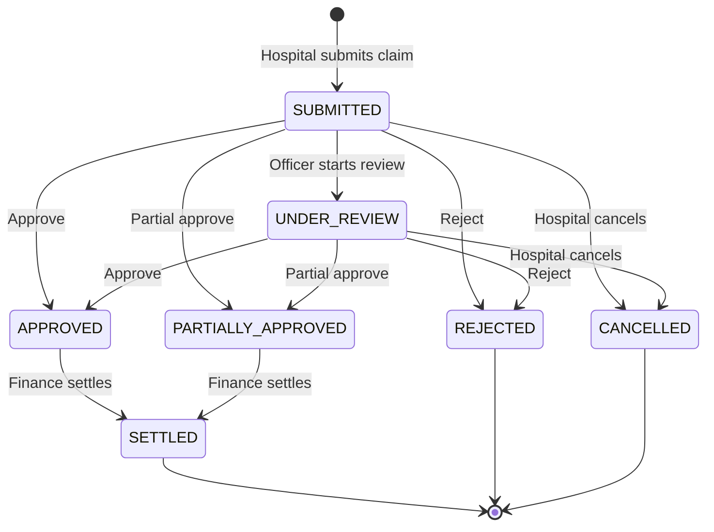
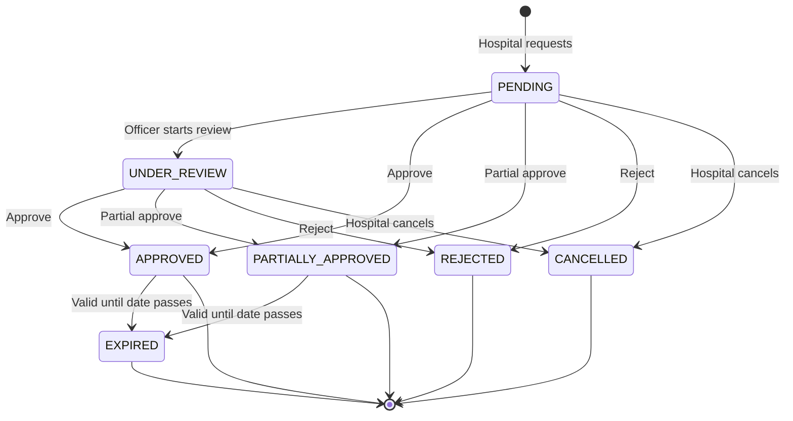
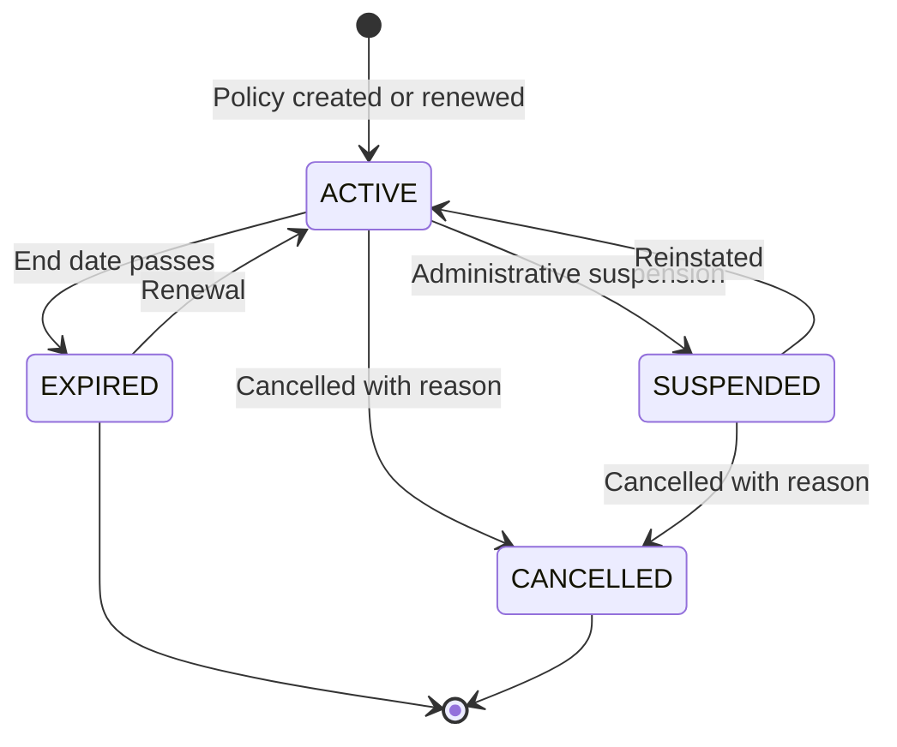

# Entity Relationship Diagram

## ER Diagram

```mermaid
erDiagram
    USERS {
        bigint id PK
        varchar username UK
        varchar email UK
        varchar password
        varchar full_name
        varchar role
        boolean enabled
        datetime created_at
        datetime updated_at
    }

    HOSPITALS {
        bigint id PK
        varchar hospital_code UK
        varchar name
        varchar license_number UK
        varchar email
        varchar phone
        varchar address
        varchar contact_person
        boolean active
        datetime created_at
        datetime updated_at
    }

    PATIENTS {
        bigint id PK
        varchar patient_code UK
        varchar first_name
        varchar last_name
        date date_of_birth
        varchar gender
        varchar email
        varchar phone
        varchar address
        boolean active
        datetime created_at
        datetime updated_at
    }

    INSURANCE_POLICIES {
        bigint id PK
        varchar policy_number UK
        bigint patient_id FK
        varchar provider_name
        varchar policy_type
        varchar status
        date start_date
        date end_date
        decimal sum_insured
        decimal utilized_amount
        decimal deductible_amount
        decimal co_payment_percentage
        int waiting_period_days
        decimal premium_amount
        int renewal_count
        datetime last_renewed_at
        varchar cancellation_reason
        bigint version
        datetime created_at
        datetime updated_at
    }

    POLICY_COVERAGES {
        bigint id PK
        bigint policy_id FK
        varchar coverage_type
        decimal coverage_limit
        decimal utilized_amount
        boolean active
        bigint version
        datetime created_at
        datetime updated_at
    }

    POLICY_EXCLUSIONS {
        bigint id PK
        bigint policy_id FK
        varchar treatment_category
        varchar reason
        datetime created_at
        datetime updated_at
    }

    PRE_AUTHORIZATIONS {
        bigint id PK
        varchar reference_number UK
        bigint patient_id FK
        bigint policy_id FK
        bigint hospital_id FK
        varchar treating_doctor
        varchar diagnosis_code
        varchar procedure_code
        varchar treatment_category
        varchar treatment_description
        decimal estimated_cost
        date requested_date
        varchar status
        decimal approved_amount
        date valid_until
        varchar remarks
        bigint requested_by FK
        bigint reviewed_by FK
        datetime decision_date
        bigint version
        datetime created_at
        datetime updated_at
    }

    CLAIMS {
        bigint id PK
        varchar claim_number UK
        varchar claim_fingerprint UK
        bigint patient_id FK
        bigint policy_id FK
        bigint hospital_id FK
        bigint pre_authorization_id FK
        varchar treating_doctor
        varchar diagnosis_code
        varchar procedure_code
        varchar treatment_category
        date admission_date
        date discharge_date
        date claim_date
        decimal claimed_amount
        varchar invoice_number
        varchar description
        varchar status
        decimal deductible_applied
        decimal co_payment_amount
        decimal non_covered_amount
        decimal approved_amount
        decimal patient_responsibility
        varchar rejection_reason
        varchar adjudication_notes
        bigint submitted_by FK
        bigint reviewed_by FK
        bigint adjudicated_by FK
        datetime reviewed_at
        datetime adjudicated_at
        bigint version
        datetime created_at
        datetime updated_at
    }

    CLAIM_SETTLEMENTS {
        bigint id PK
        varchar settlement_number UK
        bigint claim_id FK, UK
        decimal approved_amount
        decimal paid_amount
        decimal patient_responsibility
        varchar payment_mode
        varchar payment_reference UK
        varchar status
        bigint processed_by FK
        datetime processed_at
        varchar remarks
        bigint version
        datetime created_at
        datetime updated_at
    }

    AUDIT_LOGS {
        bigint id PK
        bigint claim_id FK
        varchar entity_type
        bigint entity_id
        varchar action
        bigint performed_by FK
        varchar details
        datetime created_at
        datetime updated_at
    }

    PATIENTS ||--o{ INSURANCE_POLICIES : holds
    INSURANCE_POLICIES ||--o{ POLICY_COVERAGES : defines
    INSURANCE_POLICIES ||--o{ POLICY_EXCLUSIONS : defines
    PATIENTS ||--o{ PRE_AUTHORIZATIONS : requests
    INSURANCE_POLICIES ||--o{ PRE_AUTHORIZATIONS : covers
    HOSPITALS ||--o{ PRE_AUTHORIZATIONS : submits
    USERS ||--o{ PRE_AUTHORIZATIONS : requested_by
    USERS ||--o{ PRE_AUTHORIZATIONS : reviewed_by
    PATIENTS ||--o{ CLAIMS : submits
    INSURANCE_POLICIES ||--o{ CLAIMS : validates
    HOSPITALS ||--o{ CLAIMS : files
    PRE_AUTHORIZATIONS |o--o{ CLAIMS : authorizes
    USERS ||--o{ CLAIMS : submitted_by
    USERS ||--o{ CLAIMS : reviewed_by
    USERS ||--o{ CLAIMS : adjudicated_by
    CLAIMS ||--o| CLAIM_SETTLEMENTS : settles
    USERS ||--o{ CLAIM_SETTLEMENTS : processed_by
    CLAIMS ||--o{ AUDIT_LOGS : records
    USERS ||--o{ AUDIT_LOGS : performed_by
```

## Relationship Summary

| Parent | Child | Cardinality | Key | Notes |
|---|---|---|---|---|
| patients | insurance_policies | 1 : N | patient_id | A patient can hold multiple policies over time |
| insurance_policies | policy_coverages | 1 : N | policy_id | One row per treatment category |
| insurance_policies | policy_exclusions | 1 : N | policy_id | One row per excluded treatment category |
| patients | pre_authorizations | 1 : N | patient_id | Requests are tied to a single patient |
| insurance_policies | pre_authorizations | 1 : N | policy_id | Approval is limited by policy and category limits |
| hospitals | pre_authorizations | 1 : N | hospital_id | Requesting hospital |
| users | pre_authorizations | 1 : N | requested_by, reviewed_by | Workflow actors |
| patients | claims | 1 : N | patient_id | Claim holder |
| insurance_policies | claims | 1 : N | policy_id | Claim must match the patient policy |
| hospitals | claims | 1 : N | hospital_id | Claim filing hospital |
| pre_authorizations | claims | 1 : 0..N | pre_authorization_id | Optional link to the approving pre-authorization |
| users | claims | 1 : N | submitted_by, reviewed_by, adjudicated_by | Workflow actors |
| claims | claim_settlements | 1 : 1 | claim_id | A claim can be settled at most once |
| claims | audit_logs | 1 : N | claim_id | Claim activity history |
| users | audit_logs | 1 : N | performed_by | Acting user |

## Key Uniqueness Constraints

| Constraint | Columns | Purpose |
|---|---|---|
| uk_claims_fingerprint | claim_fingerprint | Duplicate claim detection across all submissions |
| uk_claims_hospital_invoice | hospital_id, invoice_number | Prevent reusing an invoice number at the same hospital |
| uk_policy_coverage_type | policy_id, coverage_type | One coverage row per treatment category |
| uk_policy_exclusion_type | policy_id, treatment_category | One exclusion row per treatment category |
| uk_settlements_claim | claim_id | Single settlement per claim |
| uk_settlements_reference | payment_reference | Prevent duplicate payment references |
| uk_preauth_reference | reference_number | Unique business reference |
| uk_claims_number | claim_number | Unique business reference |

## Status Lifecycles

