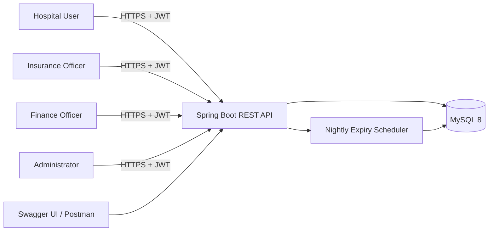
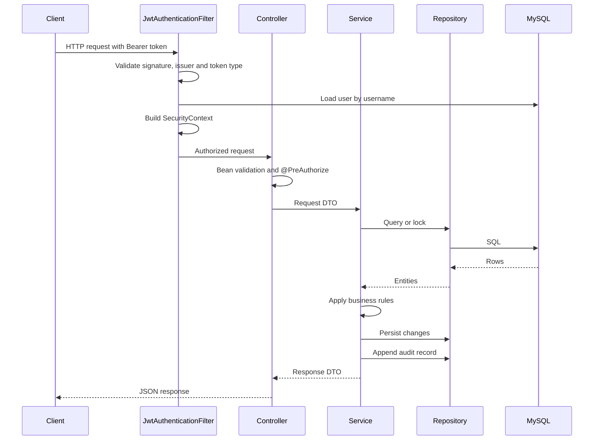
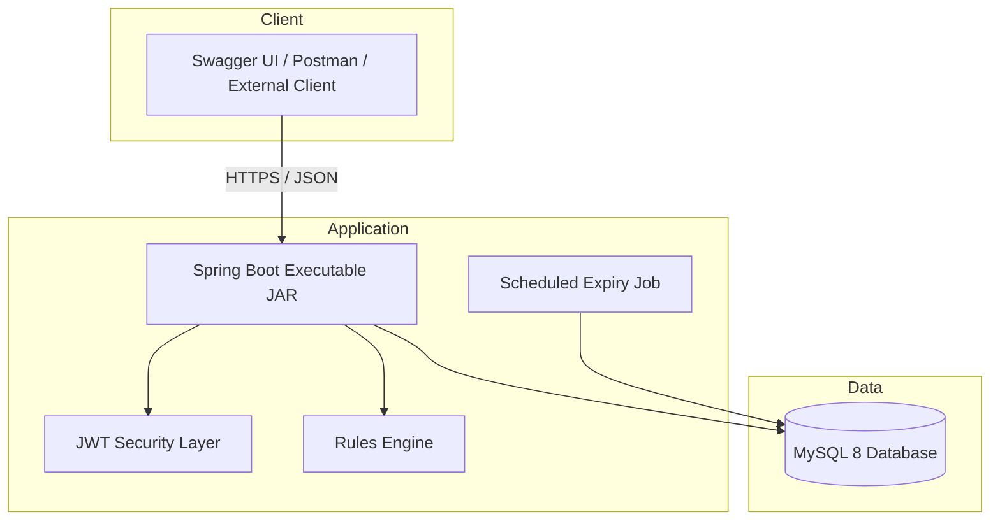
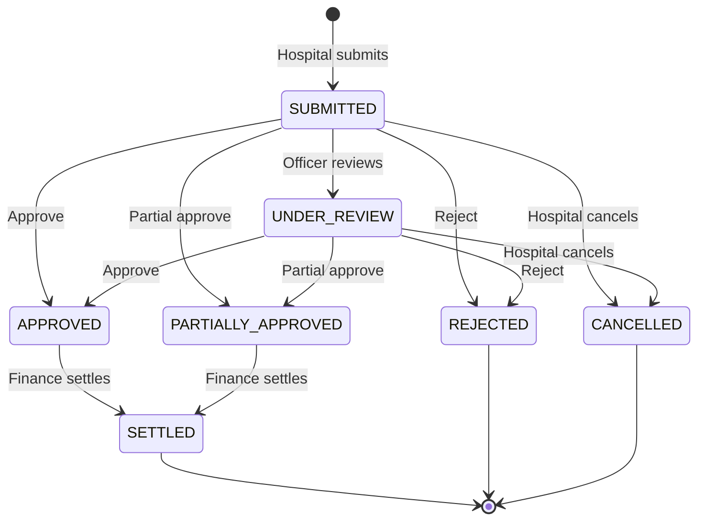
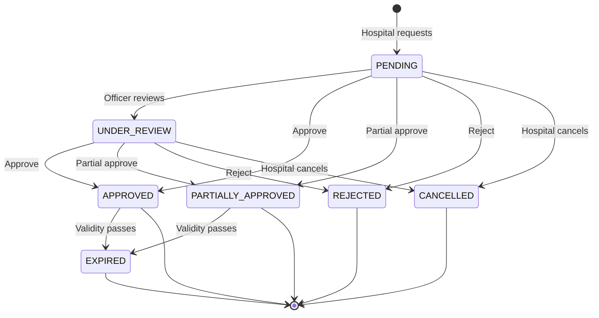
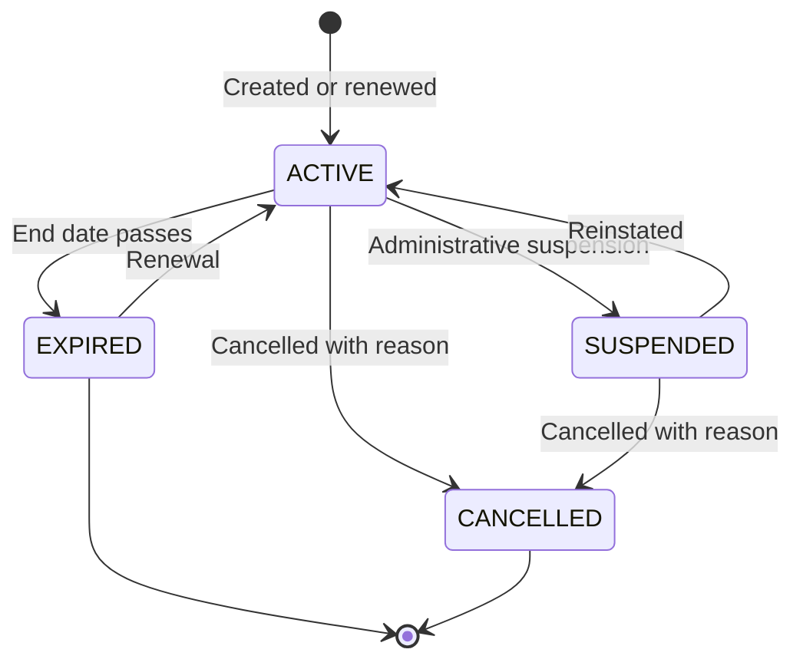
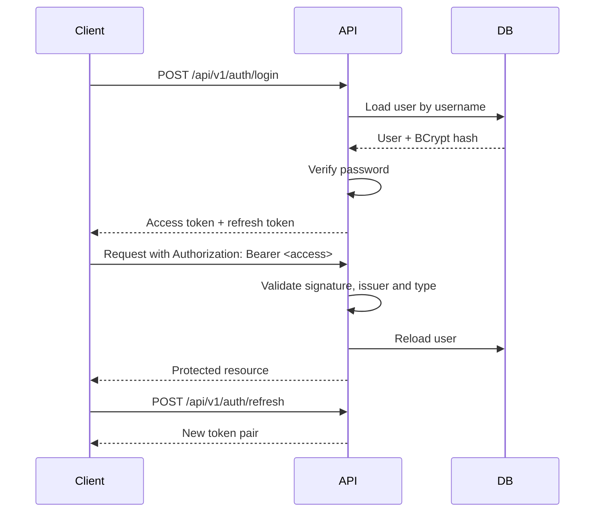

# Healthcare Insurance Claim & Pre-Authorization Management System

## Technical Documentation

| Item | Value |
|---|---|
| Document title | Technical Documentation |
| Project | Healthcare Insurance Claim & Pre-Authorization Management System |
| Version | 1.0 |
| Status | Final |
| Last updated | 11 November 2026 |
| Prepared by | Development Team |
| Technology | Java 17, Spring Boot 4.1.2, Spring Data JPA, Spring Security, MySQL 8, Maven, JWT, Swagger/OpenAPI |
| Source root | `F:\healthcare-insurance-system` |
| Related documents | `README.md`, `docs/database-schema.sql`, `docs/ER-DIAGRAM.md`, Postman collection |

---

## Table of Contents

1. Introduction
2. System Overview
3. Architecture
4. Technology Stack
5. Functional Design
6. Business Rules
7. Data Design
8. API Documentation
9. Security Design
10. Validation, Exception Handling, Transactions and Concurrency
11. Configuration
12. Build, Installation and Running the Application
13. Testing
14. Deployment and Operations
15. Performance and Capacity
16. Design Decisions and Trade-offs
17. Known Limitations and Future Enhancements
18. Requirement Traceability Matrix
19. Demonstration Walkthrough
20. Appendices

---

## 1. Introduction

### 1.1 Purpose

This document provides the complete technical reference for the Healthcare Insurance Claim & Pre-Authorization Management System. It describes the system context, architecture, functional modules, business rules, data model, REST API, security design, transaction and concurrency strategy, configuration, build instructions, testing approach, deployment guidance and requirement traceability.

The document is intended to support development, code review, testing, deployment, maintenance and academic or client evaluation of the project.

### 1.2 Scope

The system is a production-style REST backend that digitizes the insurance workflow between hospitals, policyholders, insurance officers and finance teams. It covers:

- User registration, authentication and role-based authorization
- Hospital and patient master data
- Insurance policy lifecycle, coverages and exclusions
- Patient eligibility verification
- Pre-authorization request, review and decision
- Claim submission, review, adjudication and cancellation
- Configurable insurance calculation rules
- Duplicate claim detection
- Claim settlement and policy utilization
- Audit history and scheduled expiry processing
- Swagger/OpenAPI documentation and a Postman demonstration collection

The scope is a backend API. A browser-based frontend is not part of this repository. Swagger UI and Postman are used as the interactive clients.

### 1.3 Intended Audience

| Audience | Use of this document |
|---|---|
| Developers | Understand package structure, domain model, business logic and coding conventions |
| Testers | Derive functional, integration, security and regression test scenarios |
| Reviewers/Evaluators | Verify requirements coverage, architecture quality and design decisions |
| DevOps/Operations | Configure environments, build artifacts, deploy and monitor the application |
| API consumers | Understand endpoints, payloads, status codes and authentication |

### 1.4 Definitions and Acronyms

| Term | Meaning |
|---|---|
| Claim | A request by a hospital for reimbursement of treatment provided to a patient |
| Pre-authorization | An approval request submitted before treatment to establish coverage and an approved amount |
| Policy | The insurance contract that defines coverage limits, validity, deductible and co-payment |
| Coverage | A per-treatment-category limit within a policy |
| Exclusion | A treatment category that the policy does not cover |
| Eligibility | The result of checking whether a patient, policy and treatment meet coverage conditions |
| Adjudication | The insurance officer's decision to approve, partially approve or reject a claim |
| Settlement | The finance process that records payment and consumes policy coverage |
| Deductible | A fixed amount deducted from the eligible amount before co-payment |
| Co-payment | A percentage of the amount after deductible paid by the patient |
| JWT | JSON Web Token used for stateless authentication |
| RBAC | Role-Based Access Control |
| DTO | Data Transfer Object used at the API boundary |
| Entity | A JPA-mapped persistent domain object |

---

## 2. System Overview

### 2.1 Business Problem

Insurance claim processing involves multiple parties and strict financial controls. Manual processing creates delays, duplicate payments, inconsistent coverage calculations, weak audit trails and limited visibility. The system addresses these problems with a centralized API that enforces:

- Who can perform each operation
- Which policy and coverage apply
- How much the insurer should pay
- Whether a claim duplicates an earlier claim
- Which state transitions are valid
- What evidence exists for every decision

### 2.2 Objectives

- Provide a secure, auditable claim and pre-authorization workflow.
- Enforce insurance rules consistently at eligibility, adjudication and settlement.
- Prevent duplicate claims through deterministic fingerprinting and database constraints.
- Maintain financial consistency under concurrent operations.
- Expose a documented REST API that is easy to integrate and demonstrate.
- Support local development with both MySQL and an H2 fallback profile.

### 2.3 Functional Modules

| Module | Capabilities |
|---|---|
| Authentication | Login, token refresh, current profile, administrator-only registration |
| User management | List users, enable or disable accounts |
| Hospital management | Create, update, retrieve and search hospitals |
| Patient management | Create, update, retrieve and search patients |
| Policy management | Create, update, renew, change status, list and filter policies |
| Coverage management | Add, update and list per-category coverage limits |
| Exclusion management | Add, list and remove excluded treatment categories |
| Eligibility | Verify patient, policy, waiting period, coverage and exclusions; estimate payable amount |
| Pre-authorization | Request, list, retrieve, review, decide, cancel and expire approvals |
| Claim management | Submit, list, retrieve, review, preview adjudication, adjudicate and cancel claims |
| Rules engine | Calculate eligible amount, deductible, co-payment, approved amount and patient responsibility |
| Duplicate detection | SHA-256 fingerprint and unique invoice constraint |
| Settlement | Process payment, update utilization, prevent double settlement |
| Audit | Record and query all material business actions |
| Scheduling | Expire policies and pre-authorizations nightly |
| Documentation | Swagger/OpenAPI, Postman collection, schema and ER diagram |

### 2.4 Actors and Responsibilities

| Actor | Role code | Responsibilities |
|---|---|---|
| Administrator | `ADMIN` | Manage users and hospitals, read all business data, inspect audit records |
| Hospital user | `HOSPITAL` | Register patients, verify eligibility, request pre-authorizations, submit and cancel claims, view claim audit |
| Insurance officer | `INSURANCE_OFFICER` | Manage policies and coverages, review and decide pre-authorizations, review and adjudicate claims |
| Finance officer | `FINANCE_OFFICER` | Settle approved claims and query settlements |

### 2.5 System Context



The application is stateless with respect to HTTP sessions. All business state is stored in the relational database. Authentication state is carried in signed JWTs. The only in-memory state is the request-scoped security context and short-lived service objects.

---

## 3. Architecture

### 3.1 Architectural Style

The system uses a layered monolithic architecture with clear separation of concerns:

- REST controllers handle HTTP concerns only.
- Service interfaces define business capabilities.
- Service implementations enforce business rules and transactions.
- Repositories encapsulate persistence.
- Entities represent the domain and database mapping.
- The rules engine is a pure, reusable calculation component.
- Cross-cutting concerns are handled by security filters, exception advice, specifications, mappers and utilities.

The design is intentionally modular so that modules can be extracted into services later without changing the API contract.

### 3.2 Logical Layers

| Layer | Package | Responsibility |
|---|---|---|
| API | `controller` | Routing, request validation, role checks, HTTP status codes |
| Service contract | `service` | Business capabilities exposed to controllers |
| Service implementation | `service.impl` | Business rules, orchestration, transactions, audit writes |
| Data access | `repository` | Spring Data JPA repositories, specifications, lock queries |
| Domain | `entity` | JPA entities, relationships, lifecycle timestamps, versions |
| Rules | `rules` | Stateless insurance calculation engine |
| Security | `security`, `config` | JWT filter, token service, principal, filter chain, CORS |
| Cross-cutting | `exception`, `specification`, `mapper`, `util` | Error handling, filters, DTO mapping, helpers |
| Configuration | `config` | Properties binding, bootstrap data, OpenAPI, scheduling |
| Scheduling | `scheduler` | Nightly expiry jobs |

Dependency direction is one-way:

```text
Controller -> Service interface -> Service implementation -> Repository -> Entity -> Database
```

Controllers never access repositories directly. Repositories never depend on controllers or services. The rules engine depends only on domain entities and value objects.

### 3.3 Package Structure

```text
com.healthcare.claimsystem
|-- config
|   |-- AppProperties
|   |-- DataInitializer
|   |-- DemoDataInitializer
|   |-- OpenApiConfig
|   |-- SchedulingConfig
|   `-- SecurityConfig
|-- controller
|   |-- AuthController
|   |-- UserController
|   |-- HospitalController
|   |-- PatientController
|   |-- PolicyController
|   |-- EligibilityController
|   |-- PreAuthorizationController
|   |-- ClaimController
|   |-- SettlementController
|   `-- AuditController
|-- dto
|   |-- auth
|   |-- user
|   |-- hospital
|   |-- patient
|   |-- policy
|   |-- eligibility
|   |-- preauthorization
|   |-- claim
|   |-- settlement
|   |-- audit
|   `-- common
|-- entity
|   |-- enums
|   |-- BaseEntity
|   |-- User
|   |-- Hospital
|   |-- Patient
|   |-- InsurancePolicy
|   |-- PolicyCoverage
|   |-- PolicyExclusion
|   |-- PreAuthorization
|   |-- Claim
|   |-- ClaimSettlement
|   `-- AuditLog
|-- exception
|-- mapper
|-- repository
|-- rules
|-- scheduler
|-- security
|-- service
|   `-- impl
|-- specification
`-- util
```

### 3.4 Request Lifecycle



### 3.5 Component Responsibilities

| Component | Responsibility |
|---|---|
| `JwtAuthenticationFilter` | Extracts and validates the access token, reloads the user, populates the security context |
| `JwtService` | Issues and parses access and refresh tokens |
| `CustomUserDetailsService` | Loads user details for authentication and token validation |
| `SecurityConfig` | Defines stateless security, public routes, password encoder, CORS and handlers |
| `GlobalExceptionHandler` | Converts exceptions into the standard `ApiError` contract |
| `AppProperties` | Binds and validates `app.*` configuration |
| `DataInitializer` | Creates the bootstrap administrator on first startup |
| `DemoDataInitializer` | Creates demo users and master data when explicitly enabled |
| `OpenApiConfig` | Defines API metadata and the bearer authentication scheme |
| `ExpiryScheduler` | Expires policies and pre-authorizations nightly |
| `InsuranceRulesEngine` | Performs the insurance calculation without persistence side effects |
| `ClaimFingerprint` | Produces deterministic SHA-256 duplicate-detection hashes |
| `PageableUtils` | Sanitizes sort fields and page sizes |
| `ReferenceNumberGenerator` | Generates human-readable business references |

### 3.6 Design Patterns

| Pattern | Application |
|---|---|
| Layered architecture | Controller, service, repository separation |
| Repository | Spring Data JPA repositories for persistence |
| DTO / Mapper | Request and response records mapped from entities |
| Strategy-like rules component | Stateless `InsuranceRulesEngine` reused by eligibility and adjudication |
| Specification | Dynamic filtering for list endpoints |
| Template method / advice | Global exception handling through `@RestControllerAdvice` |
| Filter chain | JWT authentication filter in Spring Security |
| Dependency injection | Constructor injection through Lombok `@RequiredArgsConstructor` |
| Optimistic and pessimistic locking | Version columns and `SELECT ... FOR UPDATE` queries |
| Configuration properties | Typed, validated `@ConfigurationProperties` |

### 3.7 Deployment Topology



The application is packaged as a single executable JAR. It can run on a virtual machine, container platform or application server environment. MySQL is the production database. The `dev` profile uses a file-based H2 database for local demonstration without MySQL credentials.

### 3.8 Non-Functional Characteristics

| Characteristic | Design approach |
|---|---|
| Security | BCrypt password hashing, signed JWTs, method-level authorization, stateless sessions |
| Consistency | Declared transactions, pessimistic locks for decisions and settlement, unique constraints |
| Auditability | Every material action writes an audit record in the same transaction |
| Maintainability | Layered packages, service interfaces, DTO records, mappers |
| Testability | Pure rules engine, Mockito unit tests, H2 integration tests |
| Portability | Maven wrapper, Java 17, environment-driven configuration |
| Scalability | Stateless API instances; database-backed consistency; scheduler requires single-runner coordination when scaled |
| Observability | Structured startup, scheduler and error logs; Actuator can be added without architectural change |

---

## 4. Technology Stack

| Component | Version/Implementation | Purpose |
|---|---|---|
| Java | 17 | Language and runtime |
| Spring Boot | 4.1.2 | Application framework and auto-configuration |
| Spring Framework | 7.x | Core container, MVC, transactions |
| Spring Data JPA / Hibernate | Boot managed, Hibernate 7.4.13.Final | ORM and repository abstraction |
| Spring Security | 7.1.2 | Authentication, authorization, filter chain |
| MySQL | 8.x (verified 8.0.46 locally) | Production relational database |
| MySQL Connector/J | 9.7.0 (Boot managed) | JDBC driver |
| H2 | 2.4.240 | `dev` profile database and test database |
| JJWT | 0.12.6 | JWT creation and validation |
| springdoc-openapi | 3.2.0 | OpenAPI 3 and Swagger UI |
| Lombok | 1.18.48 (Boot managed) | Boilerplate reduction |
| Jakarta Bean Validation | 3.1.1 | Request validation |
| JUnit 5 / Mockito / AssertJ | Boot managed | Unit and integration testing |
| Maven Wrapper | 3.9.16 | Reproducible build |
| Docker Compose | MySQL service | Local database provisioning |

---

## 5. Functional Design

### 5.1 Authentication and User Management

Endpoints:

- `POST /api/v1/auth/login` authenticates a user and issues an access token and a refresh token.
- `POST /api/v1/auth/refresh` accepts a refresh token and issues a new token pair.
- `GET /api/v1/auth/me` returns the authenticated user's profile.
- `POST /api/v1/auth/register` is restricted to administrators.

Rules:

- Usernames are unique and restricted to letters, digits, dots, underscores and hyphens.
- Emails are unique and stored in lower case.
- Passwords are BCrypt-hashed with strength 12.
- A bootstrap administrator is created on first startup from `app.bootstrap-admin.*`.
- Administrators can enable or disable users.
- An administrator cannot disable their own account.
- Disabling a user takes effect on the next request because the JWT filter reloads the user from the database.

### 5.2 Hospital Management

- Hospital codes and license numbers are unique.
- If a hospital code is omitted, a reference is generated with the `HSP` prefix.
- Hospitals can be listed with `active` and `search` filters.
- Only administrators can create or update hospitals; all authenticated roles can read them.
- Create and update operations are audited.

### 5.3 Patient Management

- Patient codes are generated with the `PAT` prefix.
- Administrators and hospital users can create or update patients.
- All authenticated roles can read patients.
- Patient data includes name, date of birth, gender, contact details and active status.
- Create and update operations are audited.

### 5.4 Policy Lifecycle and Coverage

Supported operations:

- Create and update a policy
- Renew a policy with an optional sum-insured increase and premium update
- Activate, suspend or cancel a policy
- Add and update per-category coverages
- Add, list and remove exclusions
- List policies with filters for patient, status, type, policy number, provider and expiry date

Policy rules:

- The policy end date cannot precede the start date.
- A policy created with an end date in the past is stored as `EXPIRED`.
- The policyholder cannot be changed after creation.
- Sum insured cannot be reduced below the utilized amount.
- Coverage limits cannot be reduced below the utilized amount.
- Coverage type cannot be changed after creation.
- A suspended or cancelled policy cannot be renewed.
- A cancelled policy cannot be reactivated or suspended.
- Activating a policy whose end date has passed requires renewal first.
- Suspension and cancellation require a reason.
- Expiration is system-managed; clients cannot set status to `EXPIRED`.
- Renewal extends the end date, optionally increases the sum insured and premium, increments the renewal count and records the renewal timestamp.
- Policy numbers are generated with the `POL` prefix when omitted.

Policy status values: `ACTIVE`, `EXPIRED`, `SUSPENDED`, `CANCELLED`.

Coverage categories: `CONSULTATION`, `HOSPITALIZATION`, `SURGERY`, `MEDICATION`, `DIAGNOSTIC`, `MATERNITY`, `DENTAL`, `VISION`, `EMERGENCY`.

### 5.5 Eligibility Verification

`POST /api/v1/eligibility/verify` accepts a patient id, policy number, treatment category, optional estimated cost and optional service date.

The service checks:

1. The patient exists.
2. The policy exists and belongs to the patient.
3. The patient is active.
4. The policy status is `ACTIVE`.
5. The service date is within the policy period.
6. The waiting period has elapsed.
7. An active coverage exists for the category.
8. Policy and category remaining amounts are positive.
9. The category is not excluded.

The response includes remaining policy and category amounts, waiting-period end date, deductible, co-payment, estimated insurer payable amount, estimated patient responsibility, an `eligible` flag and human-readable reasons when not eligible.

The estimate uses the same `InsuranceRulesEngine` as adjudication, ensuring consistency between the pre-check and the final calculation. Each verification is audited on the policy entity.

### 5.6 Pre-Authorization Workflow

```text
PENDING -> UNDER_REVIEW -> APPROVED | PARTIALLY_APPROVED | REJECTED
PENDING | UNDER_REVIEW -> CANCELLED
APPROVED | PARTIALLY_APPROVED -> EXPIRED
```

Request validation:

- Patient, policy and hospital must exist and be active; the policy must belong to the patient.
- The policy must be active and the requested date must be within the policy period and after the waiting period.
- An active coverage must exist for the treatment category.
- The treatment category must not be excluded.
- An active request for the same patient and procedure code cannot already exist.
- The estimated cost must be positive.

Decision rules:

- `APPROVE`: amount defaults to the estimated cost; it cannot exceed the estimated cost, remaining policy coverage or remaining category coverage.
- `PARTIAL_APPROVE`: amount is mandatory and must be lower than the estimated cost and within remaining limits.
- `REJECT`: remarks are mandatory; approved amount is zero.
- The validity date defaults to 30 days from the decision and cannot be in the past.
- Decisions are permitted only from `PENDING` or `UNDER_REVIEW`.
- A review records the reviewing officer; a direct decision also records the reviewer.
- Approval does not consume coverage; coverage is consumed at settlement.
- Cancellation is allowed only before a decision.
- Approvals expire after their validity date.

### 5.7 Claim Submission

Validation:

- Patient, policy and hospital must exist.
- The policy must belong to the patient; patient and hospital must be active.
- The policy must not be cancelled or suspended.
- The discharge date cannot precede the admission date.
- The claim date cannot precede admission or discharge.
- Service dates must fall inside the policy period. This permits a claim to be filed after policy expiry for treatment that occurred during the policy period.
- An optional pre-authorization must belong to the same patient, policy, hospital and treatment category, must be approved or partially approved, must be valid for the admission date and must have a positive approved amount.
- The invoice number must be unique within the hospital.
- The claim fingerprint must be unique across all claims.

Claim numbers are generated with the `CLM` prefix. New claims start in `SUBMITTED`.

### 5.8 Claim Review and Adjudication

- Review requires status `SUBMITTED` and moves the claim to `UNDER_REVIEW`.
- Preview is available for `SUBMITTED` and `UNDER_REVIEW` and returns the full calculation without persisting decision fields.
- Adjudication is available for `SUBMITTED` and `UNDER_REVIEW`.
- `APPROVE` uses the calculated approved amount and requires the claim to be payable.
- `PARTIAL_APPROVE` requires an amount greater than zero, lower than the claimed amount and no higher than the calculated maximum.
- `REJECT` requires a reason and records zero approved amount.
- If the claim was not explicitly reviewed, adjudication records the officer as reviewer and the reviewer timestamp.
- Adjudication records the officer, timestamp and notes.
- Rejection records the reason and marks the full claimed amount as non-covered.
- Updates are guarded by a pessimistic lock.
- Cancellation is allowed only from `SUBMITTED` or `UNDER_REVIEW`.

Audit actions: `CLAIM_SUBMITTED`, `CLAIM_REVIEWED`, `CLAIM_ADJUDICATED`, `CLAIM_CANCELLED`, `CLAIM_SETTLED`.

### 5.9 Insurance Rules Engine

`InsuranceRulesEngine` is a stateless Spring component. It receives the claim amount, service date, policy, coverage, exclusion state and optional pre-authorization limit, and returns an `AdjudicationCalculation`.

Rejection reasons are accumulated in a remarks list:

- Policy cancelled or suspended
- Service date outside the policy period
- Waiting period not elapsed
- Excluded treatment category
- No active coverage
- Exhausted policy coverage
- Exhausted category coverage
- Zero pre-authorization amount

The calculation order:

1. Claimed amount is normalized to two decimals.
2. Policy status, policy period, waiting period, exclusions and coverage availability are validated.
3. Eligible amount is capped by remaining policy coverage, remaining category coverage and any pre-authorization limit.
4. Deductible is applied to the eligible amount.
5. Co-payment percentage is applied to the amount after deductible.
6. Approved amount is the amount after deductible and co-payment.
7. Patient responsibility is `claimed - approved`.

Formula:

```text
eligible        = min(claimed, policyRemaining, categoryRemaining, preAuthorizationLimit)
deductible      = min(policyDeductible, eligible)
afterDeductible = eligible - deductible
coPayment       = afterDeductible x coPaymentPercentage / 100
approved        = afterDeductible - coPayment
patientShare    = claimed - approved
```

All monetary values use scale 2 and `HALF_UP` rounding. Deductible and co-payment reduce the insurer payable amount. Patient responsibility includes non-covered amounts, deductible and co-payment.

### 5.10 Duplicate Claim Detection

Fingerprint payload:

```text
patientId|policyId|hospitalId|PROCEDURE_CODE|admissionDate|dischargeDate|claimedAmount
```

Normalization:

- Procedure code is trimmed and upper-cased.
- Discharge date is empty when absent.
- Claimed amount is scaled to two decimals.
- Components are joined with `|`.
- SHA-256 is computed over UTF-8 bytes and hex-encoded.

The fingerprint column is unique. Independently, `(hospital_id, invoice_number)` is unique. Both the pre-check and the database constraint produce HTTP 409; the database path handles concurrent submissions.

### 5.11 Settlement

Preconditions:

- The claim exists and is locked.
- The claim is not already settled and has no existing settlement record.
- The claim status is `APPROVED` or `PARTIALLY_APPROVED`.
- The approved amount is positive.
- The payment reference is unique.
- The policy and coverage are locked.
- Coverage exists and is active.
- The approved amount does not exceed remaining policy or category coverage.

Effects, all in one transaction:

1. Increase the policy utilized amount.
2. Increase the category utilized amount.
3. Set the claim status to `SETTLED`.
4. Create a settlement record with `PROCESSED` status, payment mode, reference and processor.
5. Append a `CLAIM_SETTLED` audit entry.

Payment modes: `BANK_TRANSFER`, `CHEQUE`, `UPI`, `CARD`.

Settlement numbers are generated with the `STL` prefix. A claim can be settled at most once.

### 5.12 Audit Management

Audit records include:

- Optional claim reference
- Entity type and entity id
- Action
- Acting user
- Free-text details
- Creation timestamp

Audited actions include user registration and status changes, hospital and patient changes, policy and coverage changes, eligibility checks, pre-authorization lifecycle, claim lifecycle and settlement.

Claim-specific history: `GET /api/v1/claims/{id}/audit`.

Administrator audit query: `GET /api/v1/audits` with filters for claim, entity type, action and date range.

### 5.13 Scheduled Expiry

A nightly job runs at 01:00 server time when `app.scheduling.enabled=true`:

- Active policies whose end date is before today become `EXPIRED`.
- Approved or partially approved pre-authorizations whose validity date is before today become `EXPIRED`.

The job uses bulk update queries and logs the number of affected rows.

### 5.14 State Machines

Claim lifecycle:



Pre-authorization lifecycle:



Policy lifecycle:



---

## 6. Business Rules

### 6.1 Policy Rules

| Rule | Enforcement |
|---|---|
| End date must not precede start date | Service validation |
| Past-dated policy is created as `EXPIRED` | Service rule |
| Policyholder is immutable | Update rejects a patient change with 422 |
| Sum insured cannot fall below utilized amount | Service validation |
| Coverage limit cannot fall below utilized amount | Service validation |
| Coverage type is immutable | Service validation |
| Suspended/cancelled policies cannot be renewed | State validation |
| Cancelled policy cannot be reactivated or suspended | State transition validation |
| Expired policy must be renewed before activation | State validation |
| Suspension and cancellation require a reason | Service validation |
| Clients cannot set `EXPIRED` status | State validation |
| Renewal extends end date and increments renewal count | Service rule |

### 6.2 Eligibility Rules

A patient is eligible only when all conditions hold:

- Policy belongs to the patient and is `ACTIVE`
- Patient is active
- Service date is within the policy period
- Service date is after `startDate + waitingPeriodDays`
- Active coverage exists for the treatment category
- Policy and category remaining amounts are greater than zero
- Treatment category is not excluded

### 6.3 Pre-Authorization Rules

| Rule | Result |
|---|---|
| Policy inactive | 422 |
| Patient or hospital inactive | 422 |
| Requested date outside policy period | 422 |
| Waiting period not elapsed | 422 |
| No active coverage | 422 |
| Category excluded | 422 |
| Duplicate active request for same procedure | 409 |
| Approval exceeds estimated cost or remaining limits | 422 |
| Partial approval without amount or not lower than estimate | 422 |
| Rejection without remarks | 422 |
| Valid-until date in the past | 422 |
| Decision from terminal or invalid status | 409 |

### 6.4 Claim Rules

| Rule | Result |
|---|---|
| Policy cancelled or suspended | 422 |
| Patient or hospital inactive | 422 |
| Discharge before admission | 422 |
| Claim date before admission/discharge | 422 |
| Service date outside policy period | 422 |
| Invalid or unusable pre-authorization | 422 |
| Duplicate invoice at same hospital | 409 |
| Duplicate fingerprint | 409 |
| Review from invalid status | 409 |
| Adjudication from invalid status | 409 |
| Rejection without reason | 422 |
| Partial approval outside permitted range | 422 |
| Cancellation after decision | 409 |

### 6.5 Settlement Rules

- Only `APPROVED` or `PARTIALLY_APPROVED` claims can be settled.
- A claim can be settled only once.
- Payment references are unique.
- The claim, policy and coverage are locked pessimistically.
- Policy and category utilization are increased by the approved amount.
- Settlement fails if remaining policy or category coverage is insufficient.
- Settlement failure rolls back all changes, including the audit entry.

### 6.6 Validation Summary

Bean validation covers:

- Required fields
- String lengths and patterns
- Email and phone formats
- Positive monetary amounts
- Percentage ranges
- Past or present dates where applicable
- Future policy renewal dates

Business validation that depends on persisted state is performed in services and returns HTTP 422. Duplicate and state-transition conflicts return HTTP 409.

---

## 7. Data Design

### 7.1 Conventions

- Database: MySQL 8, InnoDB, `utf8mb4`
- Primary keys: auto-increment `BIGINT`
- Timestamps: `DATETIME(6)` in UTC
- Money: `DECIMAL(14,2)`
- Percentages: `DECIMAL(5,2)`
- Enumerations: stored as `VARCHAR`
- Optimistic locking: `version BIGINT` on mutable financial and workflow entities
- Soft deletion: not used; entities use `active` flags where appropriate
- Audit rows are append-only

All entities inherit `id`, `created_at` and `updated_at` from `BaseEntity`. Tables that require concurrency control also include `version`.

### 7.2 Entity Relationship Diagram

```mermaid
erDiagram
    USERS {
        bigint id PK
        varchar username UK
        varchar email UK
        varchar password
        varchar full_name
        varchar role
        boolean enabled
        datetime created_at
        datetime updated_at
    }

    HOSPITALS {
        bigint id PK
        varchar hospital_code UK
        varchar name
        varchar license_number UK
        varchar email
        varchar phone
        varchar address
        varchar contact_person
        boolean active
        datetime created_at
        datetime updated_at
    }

    PATIENTS {
        bigint id PK
        varchar patient_code UK
        varchar first_name
        varchar last_name
        date date_of_birth
        varchar gender
        varchar email
        varchar phone
        varchar address
        boolean active
        datetime created_at
        datetime updated_at
    }

    INSURANCE_POLICIES {
        bigint id PK
        varchar policy_number UK
        bigint patient_id FK
        varchar provider_name
        varchar policy_type
        varchar status
        date start_date
        date end_date
        decimal sum_insured
        decimal utilized_amount
        decimal deductible_amount
        decimal co_payment_percentage
        int waiting_period_days
        decimal premium_amount
        int renewal_count
        datetime last_renewed_at
        varchar cancellation_reason
        bigint version
        datetime created_at
        datetime updated_at
    }

    POLICY_COVERAGES {
        bigint id PK
        bigint policy_id FK
        varchar coverage_type
        decimal coverage_limit
        decimal utilized_amount
        boolean active
        bigint version
        datetime created_at
        datetime updated_at
    }

    POLICY_EXCLUSIONS {
        bigint id PK
        bigint policy_id FK
        varchar treatment_category
        varchar reason
        datetime created_at
        datetime updated_at
    }

    PRE_AUTHORIZATIONS {
        bigint id PK
        varchar reference_number UK
        bigint patient_id FK
        bigint policy_id FK
        bigint hospital_id FK
        varchar treating_doctor
        varchar diagnosis_code
        varchar procedure_code
        varchar treatment_category
        varchar treatment_description
        decimal estimated_cost
        date requested_date
        varchar status
        decimal approved_amount
        date valid_until
        varchar remarks
        bigint requested_by FK
        bigint reviewed_by FK
        datetime decision_date
        bigint version
        datetime created_at
        datetime updated_at
    }

    CLAIMS {
        bigint id PK
        varchar claim_number UK
        varchar claim_fingerprint UK
        bigint patient_id FK
        bigint policy_id FK
        bigint hospital_id FK
        bigint pre_authorization_id FK
        varchar treating_doctor
        varchar diagnosis_code
        varchar procedure_code
        varchar treatment_category
        date admission_date
        date discharge_date
        date claim_date
        decimal claimed_amount
        varchar invoice_number
        varchar description
        varchar status
        decimal deductible_applied
        decimal co_payment_amount
        decimal non_covered_amount
        decimal approved_amount
        decimal patient_responsibility
        varchar rejection_reason
        varchar adjudication_notes
        bigint submitted_by FK
        bigint reviewed_by FK
        bigint adjudicated_by FK
        datetime reviewed_at
        datetime adjudicated_at
        bigint version
        datetime created_at
        datetime updated_at
    }

    CLAIM_SETTLEMENTS {
        bigint id PK
        varchar settlement_number UK
        bigint claim_id FK, UK
        decimal approved_amount
        decimal paid_amount
        decimal patient_responsibility
        varchar payment_mode
        varchar payment_reference UK
        varchar status
        bigint processed_by FK
        datetime processed_at
        varchar remarks
        bigint version
        datetime created_at
        datetime updated_at
    }

    AUDIT_LOGS {
        bigint id PK
        bigint claim_id FK
        varchar entity_type
        bigint entity_id
        varchar action
        bigint performed_by FK
        varchar details
        datetime created_at
        datetime updated_at
    }

    PATIENTS ||--o{ INSURANCE_POLICIES : holds
    INSURANCE_POLICIES ||--o{ POLICY_COVERAGES : defines
    INSURANCE_POLICIES ||--o{ POLICY_EXCLUSIONS : defines
    PATIENTS ||--o{ PRE_AUTHORIZATIONS : requests
    INSURANCE_POLICIES ||--o{ PRE_AUTHORIZATIONS : covers
    HOSPITALS ||--o{ PRE_AUTHORIZATIONS : submits
    USERS ||--o{ PRE_AUTHORIZATIONS : requested_by
    USERS ||--o{ PRE_AUTHORIZATIONS : reviewed_by
    PATIENTS ||--o{ CLAIMS : submits
    INSURANCE_POLICIES ||--o{ CLAIMS : validates
    HOSPITALS ||--o{ CLAIMS : files
    PRE_AUTHORIZATIONS |o--o{ CLAIMS : authorizes
    USERS ||--o{ CLAIMS : submitted_by
    USERS ||--o{ CLAIMS : reviewed_by
    USERS ||--o{ CLAIMS : adjudicated_by
    CLAIMS ||--o| CLAIM_SETTLEMENTS : settles
    USERS ||--o{ CLAIM_SETTLEMENTS : processed_by
    CLAIMS ||--o{ AUDIT_LOGS : records
    USERS ||--o{ AUDIT_LOGS : performed_by
```



### 7.3 Data Dictionary

#### 7.3.1 `users`

| Column | Type | Constraints | Description |
|---|---|---|---|
| `id` | BIGINT | PK, auto-increment | User identifier |
| `username` | VARCHAR(50) | NOT NULL, UNIQUE | Login name |
| `email` | VARCHAR(120) | NOT NULL, UNIQUE | Email address |
| `password` | VARCHAR(100) | NOT NULL | BCrypt password hash |
| `full_name` | VARCHAR(120) | NOT NULL | Display name |
| `role` | VARCHAR(30) | NOT NULL | `ADMIN`, `HOSPITAL`, `INSURANCE_OFFICER`, `FINANCE_OFFICER` |
| `enabled` | BOOLEAN | NOT NULL, default TRUE | Account status |
| `created_at` | DATETIME(6) | NOT NULL | Creation timestamp |
| `updated_at` | DATETIME(6) | NOT NULL | Last update timestamp |

Indexes: `idx_users_role`, `idx_users_enabled`.

#### 7.3.2 `hospitals`

| Column | Type | Constraints | Description |
|---|---|---|---|
| `id` | BIGINT | PK, auto-increment | Hospital identifier |
| `hospital_code` | VARCHAR(30) | NOT NULL, UNIQUE | Business code (`HSP-...`) |
| `name` | VARCHAR(150) | NOT NULL | Hospital name |
| `license_number` | VARCHAR(60) | NOT NULL, UNIQUE | Regulatory license |
| `email` | VARCHAR(120) | NOT NULL | Contact email |
| `phone` | VARCHAR(20) | NOT NULL | Contact phone |
| `address` | VARCHAR(255) | NOT NULL | Address |
| `contact_person` | VARCHAR(120) | NOT NULL | Primary contact |
| `active` | BOOLEAN | NOT NULL, default TRUE | Operational status |
| `created_at` | DATETIME(6) | NOT NULL | Creation timestamp |
| `updated_at` | DATETIME(6) | NOT NULL | Last update timestamp |

Indexes: `idx_hospitals_name`, `idx_hospitals_active`.

#### 7.3.3 `patients`

| Column | Type | Constraints | Description |
|---|---|---|---|
| `id` | BIGINT | PK, auto-increment | Patient identifier |
| `patient_code` | VARCHAR(30) | NOT NULL, UNIQUE | Business code (`PAT-...`) |
| `first_name` | VARCHAR(80) | NOT NULL | First name |
| `last_name` | VARCHAR(80) | NOT NULL | Last name |
| `date_of_birth` | DATE | NOT NULL | Date of birth |
| `gender` | VARCHAR(20) | NOT NULL | `MALE`, `FEMALE`, `OTHER` |
| `email` | VARCHAR(120) | NULL | Email address |
| `phone` | VARCHAR(20) | NOT NULL | Phone number |
| `address` | VARCHAR(255) | NULL | Address |
| `active` | BOOLEAN | NOT NULL, default TRUE | Eligibility status |
| `created_at` | DATETIME(6) | NOT NULL | Creation timestamp |
| `updated_at` | DATETIME(6) | NOT NULL | Last update timestamp |

Indexes: `idx_patients_last_name`, `idx_patients_active`.

#### 7.3.4 `insurance_policies`

| Column | Type | Constraints | Description |
|---|---|---|---|
| `id` | BIGINT | PK, auto-increment | Policy identifier |
| `policy_number` | VARCHAR(50) | NOT NULL, UNIQUE | Business reference (`POL-...`) |
| `patient_id` | BIGINT | NOT NULL, FK -> `patients.id` | Policyholder |
| `provider_name` | VARCHAR(150) | NOT NULL | Insurance provider |
| `policy_type` | VARCHAR(30) | NOT NULL | `INDIVIDUAL`, `FAMILY`, `GROUP` |
| `status` | VARCHAR(30) | NOT NULL | `ACTIVE`, `EXPIRED`, `SUSPENDED`, `CANCELLED` |
| `start_date` | DATE | NOT NULL | Coverage start |
| `end_date` | DATE | NOT NULL | Coverage end |
| `sum_insured` | DECIMAL(14,2) | NOT NULL | Total coverage |
| `utilized_amount` | DECIMAL(14,2) | NOT NULL, default 0.00 | Amount consumed by settlements |
| `deductible_amount` | DECIMAL(14,2) | NOT NULL, default 0.00 | Fixed deductible |
| `co_payment_percentage` | DECIMAL(5,2) | NOT NULL, default 0.00 | Patient co-payment percentage |
| `waiting_period_days` | INT | NOT NULL, default 0 | Days before coverage begins |
| `premium_amount` | DECIMAL(14,2) | NOT NULL, default 0.00 | Policy premium |
| `renewal_count` | INT | NOT NULL, default 0 | Number of renewals |
| `last_renewed_at` | DATETIME(6) | NULL | Last renewal timestamp |
| `cancellation_reason` | VARCHAR(500) | NULL | Reason for cancellation |
| `version` | BIGINT | NOT NULL, default 0 | Optimistic lock version |
| `created_at` | DATETIME(6) | NOT NULL | Creation timestamp |
| `updated_at` | DATETIME(6) | NOT NULL | Last update timestamp |

Indexes: `idx_policies_patient`, `idx_policies_status`, `idx_policies_end_date`.

#### 7.3.5 `policy_coverages`

| Column | Type | Constraints | Description |
|---|---|---|---|
| `id` | BIGINT | PK, auto-increment | Coverage identifier |
| `policy_id` | BIGINT | NOT NULL, FK -> `insurance_policies.id` | Parent policy |
| `coverage_type` | VARCHAR(30) | NOT NULL | Treatment category |
| `coverage_limit` | DECIMAL(14,2) | NOT NULL | Category limit |
| `utilized_amount` | DECIMAL(14,2) | NOT NULL, default 0.00 | Amount consumed |
| `active` | BOOLEAN | NOT NULL, default TRUE | Coverage availability |
| `version` | BIGINT | NOT NULL, default 0 | Optimistic lock version |
| `created_at` | DATETIME(6) | NOT NULL | Creation timestamp |
| `updated_at` | DATETIME(6) | NOT NULL | Last update timestamp |

Unique: `(policy_id, coverage_type)`. Index: `idx_coverages_policy`.

#### 7.3.6 `policy_exclusions`

| Column | Type | Constraints | Description |
|---|---|---|---|
| `id` | BIGINT | PK, auto-increment | Exclusion identifier |
| `policy_id` | BIGINT | NOT NULL, FK -> `insurance_policies.id` | Parent policy |
| `treatment_category` | VARCHAR(30) | NOT NULL | Excluded category |
| `reason` | VARCHAR(500) | NOT NULL | Exclusion reason |
| `created_at` | DATETIME(6) | NOT NULL | Creation timestamp |
| `updated_at` | DATETIME(6) | NOT NULL | Last update timestamp |

Unique: `(policy_id, treatment_category)`. Index: `idx_exclusions_policy`.

#### 7.3.7 `pre_authorizations`

| Column | Type | Constraints | Description |
|---|---|---|---|
| `id` | BIGINT | PK, auto-increment | Pre-authorization identifier |
| `reference_number` | VARCHAR(40) | NOT NULL, UNIQUE | Business reference (`PA-...`) |
| `patient_id` | BIGINT | NOT NULL, FK -> `patients.id` | Patient |
| `policy_id` | BIGINT | NOT NULL, FK -> `insurance_policies.id` | Policy |
| `hospital_id` | BIGINT | NOT NULL, FK -> `hospitals.id` | Requesting hospital |
| `treating_doctor` | VARCHAR(120) | NOT NULL | Doctor |
| `diagnosis_code` | VARCHAR(20) | NOT NULL | Diagnosis code |
| `procedure_code` | VARCHAR(20) | NOT NULL | Procedure code |
| `treatment_category` | VARCHAR(30) | NOT NULL | Treatment category |
| `treatment_description` | VARCHAR(500) | NOT NULL | Description |
| `estimated_cost` | DECIMAL(14,2) | NOT NULL | Estimated cost |
| `requested_date` | DATE | NOT NULL | Requested service date |
| `status` | VARCHAR(30) | NOT NULL | Workflow status |
| `approved_amount` | DECIMAL(14,2) | NULL | Approved limit |
| `valid_until` | DATE | NULL | Approval validity |
| `remarks` | VARCHAR(1000) | NULL | Reviewer remarks |
| `requested_by` | BIGINT | NULL, FK -> `users.id` | Requesting user |
| `reviewed_by` | BIGINT | NULL, FK -> `users.id` | Reviewing officer |
| `decision_date` | DATETIME(6) | NULL | Decision timestamp |
| `version` | BIGINT | NOT NULL, default 0 | Optimistic lock version |
| `created_at` | DATETIME(6) | NOT NULL | Creation timestamp |
| `updated_at` | DATETIME(6) | NOT NULL | Last update timestamp |

Indexes: `idx_preauth_patient`, `idx_preauth_hospital`, `idx_preauth_policy`, `idx_preauth_status`, `idx_preauth_requested_date`.

#### 7.3.8 `claims`

| Column | Type | Constraints | Description |
|---|---|---|---|
| `id` | BIGINT | PK, auto-increment | Claim identifier |
| `claim_number` | VARCHAR(40) | NOT NULL, UNIQUE | Business reference (`CLM-...`) |
| `claim_fingerprint` | VARCHAR(64) | NOT NULL, UNIQUE | SHA-256 duplicate key |
| `patient_id` | BIGINT | NOT NULL, FK -> `patients.id` | Patient |
| `policy_id` | BIGINT | NOT NULL, FK -> `insurance_policies.id` | Policy |
| `hospital_id` | BIGINT | NOT NULL, FK -> `hospitals.id` | Hospital |
| `pre_authorization_id` | BIGINT | NULL, FK -> `pre_authorizations.id` | Optional approval |
| `treating_doctor` | VARCHAR(120) | NOT NULL | Doctor |
| `diagnosis_code` | VARCHAR(20) | NOT NULL | Diagnosis code |
| `procedure_code` | VARCHAR(20) | NOT NULL | Procedure code |
| `treatment_category` | VARCHAR(30) | NOT NULL | Treatment category |
| `admission_date` | DATE | NOT NULL | Admission date |
| `discharge_date` | DATE | NULL | Discharge date |
| `claim_date` | DATE | NOT NULL | Claim filing date |
| `claimed_amount` | DECIMAL(14,2) | NOT NULL | Amount claimed |
| `invoice_number` | VARCHAR(80) | NOT NULL | Hospital invoice |
| `description` | VARCHAR(1000) | NULL | Description |
| `status` | VARCHAR(30) | NOT NULL | Workflow status |
| `deductible_applied` | DECIMAL(14,2) | NOT NULL, default 0.00 | Deductible applied |
| `co_payment_amount` | DECIMAL(14,2) | NOT NULL, default 0.00 | Co-payment applied |
| `non_covered_amount` | DECIMAL(14,2) | NOT NULL, default 0.00 | Non-covered amount |
| `approved_amount` | DECIMAL(14,2) | NOT NULL, default 0.00 | Approved amount |
| `patient_responsibility` | DECIMAL(14,2) | NOT NULL, default 0.00 | Patient share |
| `rejection_reason` | VARCHAR(1000) | NULL | Rejection reason |
| `adjudication_notes` | VARCHAR(1000) | NULL | Officer notes |
| `submitted_by` | BIGINT | NULL, FK -> `users.id` | Submitting user |
| `reviewed_by` | BIGINT | NULL, FK -> `users.id` | Reviewing officer |
| `adjudicated_by` | BIGINT | NULL, FK -> `users.id` | Adjudicating officer |
| `reviewed_at` | DATETIME(6) | NULL | Review timestamp |
| `adjudicated_at` | DATETIME(6) | NULL | Decision timestamp |
| `version` | BIGINT | NOT NULL, default 0 | Optimistic lock version |
| `created_at` | DATETIME(6) | NOT NULL | Creation timestamp |
| `updated_at` | DATETIME(6) | NOT NULL | Last update timestamp |

Unique: `claim_fingerprint`, `(hospital_id, invoice_number)`. Indexes: `idx_claims_patient`, `idx_claims_hospital`, `idx_claims_policy`, `idx_claims_status`, `idx_claims_claim_date`.

#### 7.3.9 `claim_settlements`

| Column | Type | Constraints | Description |
|---|---|---|---|
| `id` | BIGINT | PK, auto-increment | Settlement identifier |
| `settlement_number` | VARCHAR(40) | NOT NULL, UNIQUE | Business reference (`STL-...`) |
| `claim_id` | BIGINT | NOT NULL, UNIQUE, FK -> `claims.id` | Settled claim |
| `approved_amount` | DECIMAL(14,2) | NOT NULL | Approved claim amount |
| `paid_amount` | DECIMAL(14,2) | NOT NULL | Paid amount |
| `patient_responsibility` | DECIMAL(14,2) | NOT NULL | Patient share |
| `payment_mode` | VARCHAR(30) | NOT NULL | Payment mode |
| `payment_reference` | VARCHAR(100) | NOT NULL, UNIQUE | Payment reference |
| `status` | VARCHAR(30) | NOT NULL | `PROCESSED`, `FAILED` |
| `processed_by` | BIGINT | NULL, FK -> `users.id` | Finance officer |
| `processed_at` | DATETIME(6) | NOT NULL | Processing timestamp |
| `remarks` | VARCHAR(1000) | NULL | Settlement remarks |
| `version` | BIGINT | NOT NULL, default 0 | Optimistic lock version |
| `created_at` | DATETIME(6) | NOT NULL | Creation timestamp |
| `updated_at` | DATETIME(6) | NOT NULL | Last update timestamp |

Indexes: `idx_settlements_claim`, `idx_settlements_status`.

#### 7.3.10 `audit_logs`

| Column | Type | Constraints | Description |
|---|---|---|---|
| `id` | BIGINT | PK, auto-increment | Audit identifier |
| `claim_id` | BIGINT | NULL, FK -> `claims.id` | Related claim |
| `entity_type` | VARCHAR(30) | NOT NULL | Affected entity type |
| `entity_id` | BIGINT | NOT NULL | Affected entity id |
| `action` | VARCHAR(50) | NOT NULL | Performed action |
| `performed_by` | BIGINT | NULL, FK -> `users.id` | Acting user |
| `details` | VARCHAR(2000) | NULL | Human-readable details |
| `created_at` | DATETIME(6) | NOT NULL | Creation timestamp |
| `updated_at` | DATETIME(6) | NOT NULL | Last update timestamp |

Indexes: `idx_audit_claim`, `idx_audit_entity`, `idx_audit_action`, `idx_audit_created_at`.

### 7.4 Enumerations

| Enum | Values |
|---|---|
| `Role` | `ADMIN`, `HOSPITAL`, `INSURANCE_OFFICER`, `FINANCE_OFFICER` |
| `Gender` | `MALE`, `FEMALE`, `OTHER` |
| `PolicyType` | `INDIVIDUAL`, `FAMILY`, `GROUP` |
| `PolicyStatus` | `ACTIVE`, `EXPIRED`, `SUSPENDED`, `CANCELLED` |
| `TreatmentCategory` | `CONSULTATION`, `HOSPITALIZATION`, `SURGERY`, `MEDICATION`, `DIAGNOSTIC`, `MATERNITY`, `DENTAL`, `VISION`, `EMERGENCY` |
| `PreAuthorizationStatus` | `PENDING`, `UNDER_REVIEW`, `APPROVED`, `PARTIALLY_APPROVED`, `REJECTED`, `EXPIRED`, `CANCELLED` |
| `PreAuthorizationDecision` | `APPROVE`, `PARTIAL_APPROVE`, `REJECT` |
| `ClaimStatus` | `SUBMITTED`, `UNDER_REVIEW`, `APPROVED`, `PARTIALLY_APPROVED`, `REJECTED`, `SETTLED`, `CANCELLED` |
| `AdjudicationDecision` | `APPROVE`, `PARTIAL_APPROVE`, `REJECT` |
| `SettlementStatus` | `PROCESSED`, `FAILED` |
| `PaymentMode` | `BANK_TRANSFER`, `CHEQUE`, `UPI`, `CARD` |
| `AuditEntityType` | `USER`, `HOSPITAL`, `PATIENT`, `POLICY`, `PRE_AUTHORIZATION`, `CLAIM`, `SETTLEMENT` |
| `AuditAction` | `USER_REGISTERED`, `USER_STATUS_CHANGED`, `HOSPITAL_CREATED`, `HOSPITAL_UPDATED`, `PATIENT_CREATED`, `PATIENT_UPDATED`, `POLICY_CREATED`, `POLICY_UPDATED`, `POLICY_RENEWED`, `POLICY_STATUS_CHANGED`, `COVERAGE_ADDED`, `COVERAGE_UPDATED`, `EXCLUSION_ADDED`, `EXCLUSION_REMOVED`, `ELIGIBILITY_VERIFIED`, `PRE_AUTHORIZATION_REQUESTED`, `PRE_AUTHORIZATION_REVIEWED`, `PRE_AUTHORIZATION_DECIDED`, `PRE_AUTHORIZATION_CANCELLED`, `CLAIM_SUBMITTED`, `CLAIM_REVIEWED`, `CLAIM_ADJUDICATED`, `CLAIM_CANCELLED`, `CLAIM_SETTLED` |

### 7.5 Relationships and Uniqueness

| Parent | Child | Cardinality | Key | Notes |
|---|---|---|---|---|
| patients | insurance_policies | 1 : N | patient_id | A patient can hold multiple policies |
| insurance_policies | policy_coverages | 1 : N | policy_id | One row per category |
| insurance_policies | policy_exclusions | 1 : N | policy_id | One row per excluded category |
| patients | pre_authorizations | 1 : N | patient_id | Requests belong to one patient |
| insurance_policies | pre_authorizations | 1 : N | policy_id | Approval limited by policy |
| hospitals | pre_authorizations | 1 : N | hospital_id | Requesting hospital |
| users | pre_authorizations | 1 : N | requested_by, reviewed_by | Workflow actors |
| patients | claims | 1 : N | patient_id | Claim holder |
| insurance_policies | claims | 1 : N | policy_id | Claim policy |
| hospitals | claims | 1 : N | hospital_id | Filing hospital |
| pre_authorizations | claims | 1 : 0..N | pre_authorization_id | Optional approval link |
| users | claims | 1 : N | submitted_by, reviewed_by, adjudicated_by | Workflow actors |
| claims | claim_settlements | 1 : 1 | claim_id | At most one settlement |
| claims | audit_logs | 1 : N | claim_id | Claim history |
| users | audit_logs | 1 : N | performed_by | Acting user |

Key uniqueness constraints:

- `uk_claims_fingerprint` on `claim_fingerprint`
- `uk_claims_hospital_invoice` on `(hospital_id, invoice_number)`
- `uk_policy_coverage_type` on `(policy_id, coverage_type)`
- `uk_policy_exclusion_type` on `(policy_id, treatment_category)`
- `uk_settlements_claim` on `claim_id`
- `uk_settlements_reference` on `payment_reference`
- `uk_preauth_reference` on `reference_number`
- `uk_claims_number` on `claim_number`
- `uk_policies_number` on `policy_number`

### 7.6 Indexing Strategy

Indexes target:

- Foreign keys used in joins and filters
- Workflow status columns
- Date columns used in range filters and expiry jobs
- Audit action, entity and date access patterns
- Search columns such as hospital name and patient last name

### 7.7 Data Retention and Audit Considerations

- Audit rows are append-only and should be retained according to the organization's regulatory policy.
- Financial records (policies, claims, settlements) should not be hard-deleted in production.
- Use archival jobs or read replicas for long-term reporting.
- Database backups must include the schema and all transactional tables.
- PII fields (patient contact details) should be protected at rest and in backups.

---

## 8. API Documentation

### 8.1 Conventions

- Base path: `/api/v1`
- Content type: `application/json`
- Dates: ISO-8601 `yyyy-MM-dd`
- Instants: ISO-8601 UTC
- Resource creation: HTTP 201
- Successful deletion: HTTP 204
- Money: JSON numbers with two decimal places
- Pagination: `page` (zero-based), `size`, `sort`
- Default page size: 20
- Maximum page size: 100
- Unknown sort properties are replaced by the module default

### 8.2 Authentication Flow



Token claims:

| Claim | Meaning |
|---|---|
| `iss` | Configured issuer |
| `sub` | Username |
| `uid` | User id |
| `role` | Role name |
| `type` | `ACCESS` or `REFRESH` |
| `iat` | Issued-at |
| `exp` | Expiry |

### 8.3 Endpoint Matrix

| Module | Method | Endpoint | Allowed roles |
|---|---|---|---|
| Auth | POST | `/auth/login` | Public |
| Auth | POST | `/auth/refresh` | Public |
| Auth | GET | `/auth/me` | Authenticated |
| Auth | POST | `/auth/register` | ADMIN |
| Users | GET | `/users` | ADMIN |
| Users | PATCH | `/users/{id}/status` | ADMIN |
| Hospitals | POST | `/hospitals` | ADMIN |
| Hospitals | PUT | `/hospitals/{id}` | ADMIN |
| Hospitals | GET | `/hospitals/{id}` | ADMIN, HOSPITAL, INSURANCE_OFFICER, FINANCE_OFFICER |
| Hospitals | GET | `/hospitals` | ADMIN, HOSPITAL, INSURANCE_OFFICER, FINANCE_OFFICER |
| Patients | POST | `/patients` | ADMIN, HOSPITAL |
| Patients | PUT | `/patients/{id}` | ADMIN, HOSPITAL |
| Patients | GET | `/patients/{id}` | All authenticated roles |
| Patients | GET | `/patients` | All authenticated roles |
| Policies | POST | `/policies` | ADMIN, INSURANCE_OFFICER |
| Policies | PUT | `/policies/{id}` | ADMIN, INSURANCE_OFFICER |
| Policies | GET | `/policies/{id}` | All authenticated roles |
| Policies | GET | `/policies` | All authenticated roles |
| Policies | POST | `/policies/{id}/renew` | ADMIN, INSURANCE_OFFICER |
| Policies | PATCH | `/policies/{id}/status` | ADMIN, INSURANCE_OFFICER |
| Coverages | POST | `/policies/{id}/coverages` | ADMIN, INSURANCE_OFFICER |
| Coverages | PUT | `/policies/{id}/coverages/{coverageId}` | ADMIN, INSURANCE_OFFICER |
| Coverages | GET | `/policies/{id}/coverages` | All authenticated roles |
| Exclusions | POST | `/policies/{id}/exclusions` | ADMIN, INSURANCE_OFFICER |
| Exclusions | GET | `/policies/{id}/exclusions` | All authenticated roles |
| Exclusions | DELETE | `/policies/{id}/exclusions/{exclusionId}` | ADMIN, INSURANCE_OFFICER |
| Eligibility | POST | `/eligibility/verify` | All authenticated roles |
| Pre-auth | POST | `/pre-authorizations` | HOSPITAL |
| Pre-auth | GET | `/pre-authorizations/{id}` | All authenticated roles |
| Pre-auth | GET | `/pre-authorizations` | All authenticated roles |
| Pre-auth | POST | `/pre-authorizations/{id}/review` | INSURANCE_OFFICER |
| Pre-auth | POST | `/pre-authorizations/{id}/decision` | INSURANCE_OFFICER |
| Pre-auth | POST | `/pre-authorizations/{id}/cancel` | HOSPITAL |
| Claims | POST | `/claims` | HOSPITAL |
| Claims | GET | `/claims/{id}` | All authenticated roles |
| Claims | GET | `/claims` | All authenticated roles |
| Claims | POST | `/claims/{id}/review` | INSURANCE_OFFICER |
| Claims | GET | `/claims/{id}/adjudication-preview` | INSURANCE_OFFICER |
| Claims | POST | `/claims/{id}/adjudicate` | INSURANCE_OFFICER |
| Claims | POST | `/claims/{id}/cancel` | HOSPITAL |
| Claims | GET | `/claims/{id}/audit` | All authenticated roles |
| Settlements | POST | `/settlements` | FINANCE_OFFICER |
| Settlements | GET | `/settlements/{id}` | ADMIN, FINANCE_OFFICER |
| Settlements | GET | `/settlements` | ADMIN, FINANCE_OFFICER |
| Audits | GET | `/audits` | ADMIN |
| Audits | GET | `/audits/{id}` | ADMIN |

### 8.4 Request and Response Details

#### 8.4.1 Login

Request:

```json
{
  "username": "admin",
  "password": "Admin@12345"
}
```

Response `200`:

```json
{
  "accessToken": "eyJhbGciOiJIUzM4NCJ9...",
  "refreshToken": "eyJhbGciOiJIUzM4NCJ9...",
  "tokenType": "Bearer",
  "expiresIn": 3600,
  "user": {
    "id": 1,
    "username": "admin",
    "email": "admin@healthcare.com",
    "fullName": "System Administrator",
    "role": "ADMIN",
    "enabled": true,
    "createdAt": "2026-11-05T14:50:30.216629Z"
  }
}
```

#### 8.4.2 Register User

Request:

```json
{
  "username": "hospital1",
  "email": "hospital1@healthcare.com",
  "password": "Demo@12345",
  "fullName": "City General Hospital",
  "role": "HOSPITAL"
}
```

Response `201`: `UserResponse` with `id`, `username`, `email`, `fullName`, `role`, `enabled`, `createdAt`. Passwords are never returned.

#### 8.4.3 Hospital

Request fields:

| Field | Type | Required | Rules |
|---|---|---|---|
| `hospitalCode` | string | No | Up to 30 characters, letters/digits/hyphen |
| `name` | string | Yes | Up to 150 characters |
| `licenseNumber` | string | Yes | Up to 60 characters |
| `email` | string | Yes | Valid email |
| `phone` | string | Yes | 7-20 characters |
| `address` | string | Yes | Up to 255 characters |
| `contactPerson` | string | Yes | Up to 120 characters |
| `active` | boolean | No | Defaults to true |

Response fields: `id`, `hospitalCode`, `name`, `licenseNumber`, `email`, `phone`, `address`, `contactPerson`, `active`, `createdAt`.

#### 8.4.4 Patient

Request fields:

| Field | Type | Required | Rules |
|---|---|---|---|
| `firstName` | string | Yes | Up to 80 characters |
| `lastName` | string | Yes | Up to 80 characters |
| `dateOfBirth` | date | Yes | Must be in the past |
| `gender` | enum | Yes | `MALE`, `FEMALE`, `OTHER` |
| `email` | string | No | Valid email |
| `phone` | string | Yes | 7-20 characters |
| `address` | string | No | Up to 255 characters |
| `active` | boolean | No | Defaults to true |

Response includes `patientCode` and `fullName` in addition to the request fields.

#### 8.4.5 Policy

Request fields:

| Field | Type | Required | Rules |
|---|---|---|---|
| `patientId` | long | Yes | Existing patient |
| `policyNumber` | string | No | Generated with `POL` prefix when omitted |
| `providerName` | string | Yes | Up to 150 characters |
| `policyType` | enum | Yes | `INDIVIDUAL`, `FAMILY`, `GROUP` |
| `startDate` | date | Yes | Policy start |
| `endDate` | date | Yes | Must not precede start date |
| `sumInsured` | decimal | Yes | Greater than zero |
| `deductibleAmount` | decimal | Yes | Zero or positive |
| `coPaymentPercentage` | decimal | Yes | 0-100 |
| `waitingPeriodDays` | integer | Yes | Zero or positive |
| `premiumAmount` | decimal | Yes | Zero or positive |

Policy response includes calculated `remainingAmount`, `coverages`, `exclusions`, `renewalCount`, `lastRenewedAt` and audit timestamps.

Coverage request:

```json
{
  "coverageType": "HOSPITALIZATION",
  "coverageLimit": 500000.00,
  "active": true
}
```

Renewal request:

```json
{
  "newEndDate": "2027-11-05",
  "additionalSumInsured": 100000.00,
  "premiumAmount": 25000.00
}
```

Status request:

```json
{
  "status": "SUSPENDED",
  "reason": "Premium not received"
}
```

#### 8.4.6 Eligibility

Request:

```json
{
  "patientId": 1,
  "policyNumber": "POL-20261105-AB12CD34",
  "treatmentCategory": "HOSPITALIZATION",
  "estimatedCost": 100000.00,
  "serviceDate": "2026-11-05"
}
```

Response fields: `eligible`, patient and policy identifiers, policy dates, `waitingPeriodEndDate`, `sumInsured`, `utilizedAmount`, `remainingCoverage`, category limit/utilized/remaining, deductible, co-payment percentage, estimated cost, `estimatedInsurerPayable`, `estimatedPatientResponsibility`, `reasons`, `verifiedAt`.

#### 8.4.7 Pre-Authorization

Request fields:

| Field | Type | Required | Rules |
|---|---|---|---|
| `patientId` | long | Yes | Existing active patient |
| `policyId` | long | Yes | Active policy of the patient |
| `hospitalId` | long | Yes | Active hospital |
| `treatingDoctor` | string | Yes | Up to 120 characters |
| `diagnosisCode` | string | Yes | Up to 20 characters |
| `procedureCode` | string | Yes | Up to 20 characters |
| `treatmentCategory` | enum | Yes | Covered and not excluded |
| `treatmentDescription` | string | Yes | Up to 500 characters |
| `estimatedCost` | decimal | Yes | Greater than zero |
| `requestedDate` | date | Yes | Must not be in the future |

Decision request:

```json
{
  "decision": "APPROVE",
  "approvedAmount": 90000.00,
  "remarks": "Approved subject to policy terms",
  "validUntil": "2026-12-05"
}
```

Decision values: `APPROVE`, `PARTIAL_APPROVE`, `REJECT`.

#### 8.4.8 Claim

Request fields:

| Field | Type | Required | Rules |
|---|---|---|---|
| `patientId` | long | Yes | Existing active patient |
| `policyId` | long | Yes | Policy belonging to the patient |
| `hospitalId` | long | Yes | Existing active hospital |
| `preAuthorizationId` | long | No | Must be valid for the treatment |
| `treatingDoctor` | string | Yes | Up to 120 characters |
| `diagnosisCode` | string | Yes | Up to 20 characters |
| `procedureCode` | string | Yes | Up to 20 characters |
| `treatmentCategory` | enum | Yes | Must match coverage |
| `admissionDate` | date | Yes | Not in the future |
| `dischargeDate` | date | No | Not before admission and not in the future |
| `claimDate` | date | Yes | Not before admission/discharge and not in the future |
| `claimedAmount` | decimal | Yes | Greater than zero |
| `invoiceNumber` | string | Yes | Unique per hospital |
| `description` | string | No | Up to 1000 characters |

Adjudication request:

```json
{
  "decision": "PARTIAL_APPROVE",
  "approvedAmount": 75000.00,
  "rejectionReason": null,
  "notes": "Partially approved after policy limits"
}
```

Adjudication decisions: `APPROVE`, `PARTIAL_APPROVE`, `REJECT`. Rejection requires `rejectionReason`.

Preview response fields: `claimId`, `claimNumber`, `claimedAmount`, `eligibleAmount`, `nonCoveredAmount`, `deductibleApplied`, `coPaymentAmount`, `approvedAmount`, `patientResponsibility`, `covered`, `remarks`.

#### 8.4.9 Settlement

Request:

```json
{
  "claimId": 1,
  "paymentMode": "BANK_TRANSFER",
  "paymentReference": "UTR-20261105-0001",
  "remarks": "Paid in full"
}
```

Response fields: `id`, `settlementNumber`, `claimId`, `claimNumber`, patient and policy references, `approvedAmount`, `paidAmount`, `patientResponsibility`, `paymentMode`, `paymentReference`, `status`, `processedByUsername`, `processedAt`, `remarks`, `createdAt`.

#### 8.4.10 Audit

Audit response fields: `id`, `claimId`, `claimNumber`, `entityType`, `entityId`, `action`, `performedByUsername`, `details`, `createdAt`.

### 8.5 Pagination, Sorting and Filtering

List endpoints accept:

- `page` - zero-based page number, default `0`
- `size` - page size, default `20`, maximum `100`
- `sort` - field and direction, for example `sort=createdAt,desc`
- Module filters such as `status`, `patientId`, `hospitalId`, `policyNumber`, `claimNumber`, `fromDate`, `toDate`

Allowed sort fields by module:

| Module | Sort fields |
|---|---|
| Users | `createdAt`, `username`, `email`, `fullName`, `role` |
| Hospitals | `createdAt`, `hospitalCode`, `name`, `active` |
| Patients | `createdAt`, `patientCode`, `firstName`, `lastName`, `dateOfBirth` |
| Policies | `createdAt`, `policyNumber`, `startDate`, `endDate`, `sumInsured`, `utilizedAmount`, `status`, `policyType` |
| Pre-authorizations | `createdAt`, `referenceNumber`, `requestedDate`, `estimatedCost`, `approvedAmount`, `status` |
| Claims | `createdAt`, `claimNumber`, `claimDate`, `admissionDate`, `claimedAmount`, `approvedAmount`, `status` |
| Settlements | `createdAt`, `settlementNumber`, `paidAmount`, `processedAt`, `status` |
| Audits | `createdAt`, `action`, `entityType` |

Page envelope:

```json
{
  "content": [],
  "page": 0,
  "size": 20,
  "totalElements": 0,
  "totalPages": 0,
  "first": true,
  "last": true
}
```

### 8.6 Error Contract

All application errors use:

```json
{
  "timestamp": "2026-11-05T10:15:30Z",
  "status": 400,
  "error": "Bad Request",
  "message": "Request validation failed",
  "path": "/api/v1/claims",
  "details": [
    {
      "field": "claimedAmount",
      "message": "Claimed amount must be greater than zero"
    }
  ]
}
```

Status codes:

| Status | Meaning |
|---|---|
| 200 | Successful read or update |
| 201 | Resource created |
| 204 | Successful deletion |
| 400 | Validation failure or malformed request |
| 401 | Missing, invalid or expired credentials |
| 403 | Authenticated but not authorized |
| 404 | Resource not found |
| 409 | Duplicate resource, duplicate claim or invalid state transition |
| 422 | Business rule violation |
| 500 | Unexpected server error |

Security filter errors use the same JSON shape because they occur before the dispatcher servlet.

### 8.7 Common Workflows

Pre-authorization:

```text
Login as hospital -> create/obtain patient, policy and hospital -> verify eligibility
-> submit pre-authorization -> login as insurance officer -> review -> decide
-> login as hospital -> submit claim referencing the approval
```

Claim and settlement:

```text
Login as hospital -> submit claim -> login as insurance officer -> review
-> preview adjudication -> adjudicate -> login as finance officer -> settle
-> any role -> view claim -> administrator -> view audit history
```

---

## 9. Security Design

### 9.1 Authentication

- Stateless JWT authentication with no server-side HTTP session.
- Login uses `AuthenticationManager` and `DaoAuthenticationProvider`.
- The access token is sent as `Authorization: Bearer <token>`.
- The refresh token is accepted only by `/api/v1/auth/refresh`.
- The filter reloads the user on every request; disabled users lose access immediately.
- Invalid, expired or wrong-type tokens return 401.
- Authorization failures return 403.

### 9.2 Password Storage

- BCrypt with strength 12.
- Passwords are never returned in responses.
- Raw passwords are never logged.
- The bootstrap administrator password must be changed before production use.

### 9.3 Role Matrix

| Capability | ADMIN | HOSPITAL | INSURANCE_OFFICER | FINANCE_OFFICER |
|---|---|---|---|---|
| Manage users | Yes | No | No | No |
| Manage hospitals | Yes | Read | Read | Read |
| Manage patients | Yes | Yes | Read | Read |
| Manage policies and coverages | Yes | Read | Yes | Read |
| Verify eligibility | Yes | Yes | Yes | Yes |
| Request/cancel pre-authorization | No | Yes | No | No |
| Review/decide pre-authorization | No | No | Yes | No |
| Submit/cancel claim | No | Yes | No | No |
| Review/adjudicate claim | No | No | Yes | No |
| Settle claim | No | No | No | Yes |
| View all audits | Yes | No | No | No |
| View claim audit history | Yes | Yes | Yes | Yes |

### 9.4 JWT Handling

- HMAC signing key from `app.jwt.secret`, minimum 32 characters validated at startup.
- Issuer validation on every parse.
- `type` claim prevents refresh tokens from being used as access tokens.
- Access and refresh lifetimes are configurable.
- The filter does not create a session.
- Token secret must be supplied from a secrets manager in production.

### 9.5 Transport and CORS

- CORS origins are configurable through `app.cors.allowed-origins`.
- Credentials are disabled because the API uses bearer tokens.
- Allowed methods: GET, POST, PUT, PATCH, DELETE, OPTIONS.
- CSRF is disabled because the API is stateless and token-based.
- TLS should terminate at a reverse proxy or ingress in production.
- Swagger UI and OpenAPI can be disabled or protected in public production environments.

### 9.6 Security Error Handling

- `JwtAuthenticationEntryPoint` handles unauthenticated requests.
- `JwtAccessDeniedHandler` handles authenticated but forbidden requests.
- `SecurityErrorWriter` serializes errors with the standard `ApiError` shape.
- Authentication and authorization exceptions raised inside controllers are handled by `GlobalExceptionHandler`.

### 9.7 Threat Considerations

| Threat | Mitigation |
|---|---|
| Credential theft | BCrypt hashing, TLS, short-lived access tokens, configurable refresh lifetime |
| Token replay | Signed tokens, expiry, token type validation, user reload on every request |
| Privilege escalation | Method-level role checks and least-privilege endpoint matrix |
| Duplicate claim fraud | Fingerprint uniqueness, invoice uniqueness, audit trail |
| Concurrent financial updates | Pessimistic locks for decisions and settlement, optimistic versions elsewhere |
| SQL injection | JPA parameter binding and specifications |
| Mass assignment | Explicit DTO records rather than entity binding |
| Sensitive data leakage | Password fields excluded from DTOs, standard error messages |
| Brute force | Not implemented in the application; should be enforced by rate limiting at the gateway |

### 9.8 Operational Security Checklist

- Change the bootstrap administrator password.
- Use a strong, random `JWT_SECRET` from a secrets manager.
- Restrict database privileges in production.
- Disable Swagger UI in public production environments.
- Enable TLS and trusted CORS origins.
- Monitor 401/403 rates and repeated login failures.
- Apply dependency and container image scanning.
- Back up and encrypt the database.

---

## 10. Validation, Exception Handling, Transactions and Concurrency

### 10.1 Validation Layers

| Layer | Validation |
|---|---|
| HTTP/JSON | Malformed body handling, type conversion, missing parameters |
| Bean validation | Required fields, lengths, patterns, numeric ranges, date constraints |
| Service | Ownership, status, waiting period, coverage, exclusions, duplicates, limits |
| Database | Unique constraints, foreign keys, non-null constraints |
| Security | Authentication and role authorization |

### 10.2 Exception Mapping

| Exception | HTTP status | Meaning |
|---|---|---|
| `ResourceNotFoundException` | 404 | Entity does not exist |
| `DuplicateResourceException` | 409 | Business duplicate |
| `InvalidStatusTransitionException` | 409 | Invalid workflow transition |
| `BusinessRuleException` | 422 | Rule violation |
| `MethodArgumentNotValidException` | 400 | Bean validation failure |
| `ConstraintViolationException` | 400 | Constraint validation failure |
| `HandlerMethodValidationException` | 400 | Method parameter validation |
| `MethodArgumentTypeMismatchException` | 400 | Invalid parameter type |
| `MissingServletRequestParameterException` | 400 | Missing parameter |
| `HttpMessageNotReadableException` | 400 | Malformed JSON |
| `AuthenticationException` | 401 | Invalid credentials |
| `JwtException` | 401 | Invalid or expired token |
| `AccessDeniedException` | 403 | Insufficient role |
| `DataIntegrityViolationException` | 409 | Database uniqueness or integrity conflict |
| `OptimisticLockingFailureException` | 409 | Concurrent modification |
| `PessimisticLockingFailureException` | 409 | Record locked |
| `NoResourceFoundException` | 404 | Unknown resource path |
| `Exception` | 500 | Unexpected error |

### 10.3 Transaction Strategy

- Service implementations are annotated with `@Transactional(readOnly = true)` at class level.
- Write methods override with `@Transactional`.
- Domain exceptions are unchecked, so failures trigger rollback.
- Audit entries are written in the same transaction as the business change.
- A failed operation does not leave an audit record behind.
- Controllers do not open transactions.
- Repository read-only operations use the class-level transaction.

### 10.4 Concurrency Control

| Concern | Mechanism |
|---|---|
| Duplicate claim under race | SHA-256 fingerprint plus unique constraint; integrity violation mapped to 409 |
| Duplicate invoice under race | Unique constraint on `(hospital_id, invoice_number)` |
| Concurrent claim decisions | Pessimistic lock on the claim row |
| Concurrent settlements | Pessimistic locks on claim, policy and coverage rows |
| Concurrent policy updates | Pessimistic lock for renewal/status changes; `@Version` on policy and coverage |
| Concurrent pre-authorization decisions | Pessimistic lock on the pre-authorization row |
| Lost updates | JPA optimistic locking with `@Version`; violations mapped to 409 |

The settlement lock order is claim, policy, then coverage. A consistent order avoids deadlocks between competing settlement transactions.

### 10.5 Idempotency and Retry

- Claim submission is not idempotent by request id; duplicate detection prevents repeated business submissions.
- Settlement is protected by the unique claim and payment reference constraints.
- Clients may retry after 409/423-style conflicts only after re-reading the resource.
- 500 errors should be retried only with care and an idempotency strategy at the integration layer.

---

## 11. Configuration

### 11.1 Profiles

| Profile | Purpose | Database | Demo data |
|---|---|---|---|
| default | Local/runtime MySQL | MySQL | Disabled unless `DEMO_DATA_ENABLED=true` |
| `dev` | Local demonstration without MySQL | H2 file database in MySQL mode | Enabled |
| `test` | Automated tests | H2 in-memory MySQL mode | Disabled |

### 11.2 Key Properties

| Property | Default | Purpose |
|---|---|---|
| `server.port` | `8080` | HTTP port |
| `spring.datasource.url` | MySQL localhost URL | JDBC connection |
| `spring.datasource.username` | `root` | Database user |
| `spring.datasource.password` | Environment/config value | Database password |
| `spring.jpa.hibernate.ddl-auto` | `update` | Schema strategy |
| `spring.jpa.open-in-view` | `false` | Avoids open session in view |
| `spring.data.web.pageable.default-page-size` | `20` | Default pagination |
| `spring.data.web.pageable.max-page-size` | `100` | Maximum pagination |
| `springdoc.api-docs.path` | `/v3/api-docs` | OpenAPI JSON path |
| `springdoc.swagger-ui.path` | `/swagger-ui.html` | Swagger UI path |
| `app.jwt.secret` | Development secret | HMAC signing key |
| `app.jwt.issuer` | `healthcare-insurance-system` | JWT issuer |
| `app.jwt.access-token-expiration-minutes` | `60` | Access token lifetime |
| `app.jwt.refresh-token-expiration-days` | `7` | Refresh token lifetime |
| `app.cors.allowed-origins` | localhost origins | CORS allowlist |
| `app.bootstrap-admin.*` | Admin defaults | Bootstrap administrator |
| `app.demo-data.enabled` | `false` | Demo data initializer |
| `app.scheduling.enabled` | `true` | Expiry scheduler |

### 11.3 Environment Variables

| Variable | Default | Description |
|---|---|---|
| `SERVER_PORT` | `8080` | HTTP port |
| `DB_URL` | MySQL localhost URL | JDBC URL |
| `DB_USERNAME` | `root` | Database user |
| `DB_PASSWORD` | Configured in `application.properties` | Database password |
| `DDL_AUTO` | `update` | Hibernate schema strategy |
| `JWT_SECRET` | Development secret | HMAC signing key, minimum 32 characters |
| `JWT_ACCESS_EXPIRATION_MINUTES` | `60` | Access token lifetime |
| `JWT_REFRESH_EXPIRATION_DAYS` | `7` | Refresh token lifetime |
| `CORS_ALLOWED_ORIGINS` | localhost origins | Comma-separated origins |
| `ADMIN_USERNAME` | `admin` | Bootstrap administrator username |
| `ADMIN_EMAIL` | `admin@healthcare.com` | Bootstrap administrator email |
| `ADMIN_PASSWORD` | `Admin@12345` | Bootstrap administrator password |
| `ADMIN_FULL_NAME` | `System Administrator` | Bootstrap administrator display name |
| `DEMO_DATA_ENABLED` | `false` | Enable demo data |
| `SCHEDULING_ENABLED` | `true` | Enable scheduled jobs |

Production deployments must override `JWT_SECRET` and the bootstrap administrator password.

### 11.4 IntelliJ Run Configurations

| Configuration | Profile | Database |
|---|---|---|
| `HealthcareInsuranceSystemApplication` | default | MySQL |
| `Healthcare Insurance System (H2 dev)` | `dev` | H2 file database |

The shared H2 configuration is stored in `.run/Healthcare Insurance System (H2 dev).run.xml`.

### 11.5 Logging

- Root logging level: `INFO`
- Application package logging level: `INFO`
- Startup, bootstrap, scheduler and unhandled exceptions are logged.
- SQL logging is disabled by default and can be enabled for diagnostics.
- Sensitive values such as passwords and tokens must never be logged.

---

## 12. Build, Installation and Running the Application

### 12.1 Prerequisites

- JDK 17
- MySQL 8.x for the default profile, or Docker
- No local Maven installation is required; the wrapper is included
- Optional: IntelliJ IDEA with the bundled Maven

### 12.2 MySQL Setup

Using Docker:

```bash
docker compose up -d mysql
```

The compose file creates database `healthcare_insurance` with user `healthcare` and password `healthcare123` on port 3306.

Using an existing MySQL installation:

```sql
CREATE DATABASE healthcare_insurance CHARACTER SET utf8mb4 COLLATE utf8mb4_unicode_ci;
```

The default JDBC URL includes `createDatabaseIfNotExist=true`, so a user with DDL privileges can create the schema on startup. The full DDL is in `docs/database-schema.sql`.

Set credentials when they differ from the local defaults:

```powershell
$env:DB_USERNAME = "healthcare"
$env:DB_PASSWORD = "healthcare123"
```

### 12.3 Build

```bash
./mvnw clean package
```

Windows:

```powershell
.\mvnw.cmd clean package
```

The executable artifact is:

```text
target/healthcare-insurance-system-0.0.1-SNAPSHOT.jar
```

### 12.4 Run with MySQL

```bash
java -jar target/healthcare-insurance-system-0.0.1-SNAPSHOT.jar
```

Or with Maven:

```bash
./mvnw spring-boot:run
```

Windows:

```powershell
.\mvnw.cmd spring-boot:run
```

### 12.5 Run with H2

```powershell
.\mvnw.cmd spring-boot:run -Dspring-boot.run.profiles=dev
```

In IntelliJ, select **Healthcare Insurance System (H2 dev)**. The database is stored in `data/healthcare_dev.mv.db`, uses MySQL compatibility mode and enables demo data.

### 12.6 Verify the Application

- Swagger UI: `http://localhost:8080/swagger-ui.html`
- OpenAPI JSON: `http://localhost:8080/v3/api-docs`
- Login: `POST http://localhost:8080/api/v1/auth/login`

Bootstrap login:

```json
{
  "username": "admin",
  "password": "Admin@12345"
}
```

### 12.7 Demo Data

When `app.demo-data.enabled=true` (or the `dev` profile is active), the initializer creates:

| User | Password | Role |
|---|---|---|
| `hospital1` | `Demo@12345` | `HOSPITAL` |
| `officer1` | `Demo@12345` | `INSURANCE_OFFICER` |
| `finance1` | `Demo@12345` | `FINANCE_OFFICER` |
| `admin` | `Admin@12345` | `ADMIN` |

It also creates a demo hospital, patient, active policy, coverages and exclusions.

### 12.8 Troubleshooting

| Symptom | Cause | Resolution |
|---|---|---|
| `Access denied for user` | Wrong database credentials | Set `DB_USERNAME` and `DB_PASSWORD`; verify MySQL is running |
| `Communications link failure` | MySQL not running or wrong port | Start MySQL and check the JDBC URL |
| `Port 8080 already in use` | Another process is listening | Stop the process or set `SERVER_PORT` |
| `Unsupported class file major version` | Wrong JDK | Set the project SDK and compiler target to Java 17 |
| H2 database locked | Another process holds the file | Stop the other application instance |
| 401 on protected endpoint | Missing, expired or wrong token type | Log in again and send an access token |
| 403 on protected endpoint | Role not allowed | Use an account with the required role |
| 409 on claim submission | Duplicate invoice or fingerprint | Check existing claims; use a unique invoice |
| 422 on eligibility | Policy, waiting period, coverage or exclusion rule failed | Read the `message` and `reasons` fields |
| Swagger UI 404 | Wrong path or disabled documentation | Use `/swagger-ui.html` and check springdoc settings |

---

## 13. Testing

### 13.1 Strategy

- Unit tests isolate service and utility logic with Mockito.
- Integration tests start the full Spring context, security filter chain and JPA layer against H2.
- The integration profile uses `src/test/resources/application-test.properties`.
- Test data is created through repositories and cleaned in foreign-key order.
- The bootstrap administrator is preserved across tests.
- Tests do not require a running MySQL server.

### 13.2 Test Inventory

| Test class | Type | Tests | Coverage |
|---|---|---|---|
| `HealthcareInsuranceSystemApplicationTests` | Context load | 1 | Spring context starts |
| `AuthSecurityIntegrationTest` | Integration | 10 | Login, refresh, `/me`, registration, 401/403, public OpenAPI |
| `ClaimWorkflowIntegrationTest` | Integration | 6 | Full eligibility -> pre-auth -> claim -> settlement -> audit flow; duplicates; exclusions; validation |
| `PolicyLifecycleIntegrationTest` | Integration | 4 | Policy creation, coverage, exclusions, renewal, status, RBAC, pagination |
| `InsuranceRulesEngineTest` | Unit | 7 | Deductible, co-payment, category limit, pre-auth cap, waiting period, exclusions, exhausted coverage |
| `JwtServiceTest` | Unit | 4 | Access/refresh token types, claims, invalid tokens |
| `ClaimServiceImplTest` | Unit | 7 | Duplicate detection, submission, adjudication, partial approval, workflow guards |
| `EligibilityServiceImplTest` | Unit | 5 | Eligibility, exclusions, waiting period, policy ownership |
| `PolicyServiceImplTest` | Unit | 4 | Renewal, activation guards, cancellation reason, duplicate coverage |
| `PreAuthorizationServiceImplTest` | Unit | 5 | Approval, partial approval, rejection, state transitions |
| `SettlementServiceImplTest` | Unit | 4 | Utilization updates, duplicate settlement, unapproved claim, insufficient coverage |
| `ClaimFingerprintTest` | Unit | 2 | Deterministic fingerprint and sensitivity to changes |

### 13.3 Test Results

The complete suite was executed successfully:

| Metric | Result |
|---|---|
| Test suites | 12 |
| Tests | 59 |
| Failures | 0 |
| Errors | 0 |
| Skipped | 0 |

Run the suite:

```bash
./mvnw clean test
```

Windows:

```powershell
.\mvnw.cmd clean test
```

### 13.4 Coverage Matrix

| Requirement area | Unit | Integration |
|---|---|---|
| Authentication and JWT | Yes | Yes |
| User registration and roles | - | Yes |
| Policy lifecycle | Yes | Yes |
| Coverage and exclusions | Yes | Yes |
| Eligibility | Yes | Yes |
| Pre-authorization | Yes | Yes |
| Claim submission | Yes | Yes |
| Duplicate detection | Yes | Yes |
| Adjudication | Yes | Yes |
| Settlement | Yes | Yes |
| Audit | - | Yes |
| Pagination, sorting, filters | - | Yes |
| Error handling | Yes | Yes |
| OpenAPI access | - | Yes |

### 13.5 Recommended Additional Coverage

- Testcontainers-based MySQL integration tests
- Multi-threaded concurrent claim submission and settlement tests
- API contract tests for external consumers
- Mutation testing for the rules engine
- Load and stress tests for list and adjudication endpoints
- Security scanning and dependency vulnerability checks

---

## 14. Deployment and Operations

### 14.1 Build Artifact

The Spring Boot Maven plugin produces an executable JAR containing the application and its runtime dependencies. The artifact can be started with:

```bash
java -jar healthcare-insurance-system-0.0.1-SNAPSHOT.jar
```

### 14.2 Production Configuration

| Setting | Recommendation |
|---|---|
| `DDL_AUTO` | `validate`; apply schema through Flyway or Liquibase |
| `DB_URL` | Managed MySQL endpoint with TLS |
| `DB_USERNAME` / `DB_PASSWORD` | Dedicated least-privilege user from a secrets manager |
| `JWT_SECRET` | Strong random value of at least 32 characters |
| `ADMIN_PASSWORD` | Strong unique value, changed after first login |
| `DEMO_DATA_ENABLED` | `false` |
| `SCHEDULING_ENABLED` | `true` on exactly one instance or use a distributed lock |
| Swagger | Disable or restrict in public environments |
| CORS | Only trusted frontend origins |
| Logging | Centralized, structured, with sensitive data redaction |

### 14.3 Production Checklist

- Provision MySQL 8 with backups and point-in-time recovery.
- Set `DDL_AUTO=validate` and manage schema migrations explicitly.
- Configure a strong `JWT_SECRET`.
- Override bootstrap administrator credentials.
- Disable demo data.
- Disable or secure Swagger UI.
- Configure TLS and trusted CORS origins.
- Configure log aggregation and alerting.
- Set JVM memory and connection pool limits.
- Run the expiry scheduler in a single instance or use a distributed lock.
- Configure health and readiness endpoints if the platform requires them.
- Perform load and failover testing.

### 14.4 Observability

The application logs:

- Startup and bootstrap actions
- Scheduled expiry results
- Unhandled exceptions with request path and stack trace

Recommended additions:

- Spring Boot Actuator health, metrics and info endpoints
- Micrometer metrics for HTTP latency and error rates
- Distributed tracing
- Database connection pool metrics
- Alerts for 401/403 spikes, 5xx rates and scheduler failures

### 14.5 Backup and Disaster Recovery

- Enable automated daily backups and binary log retention.
- Test restore procedures regularly.
- Store backups encrypted and in a separate failure domain.
- Define recovery point and recovery time objectives.
- Preserve audit records according to compliance requirements.
- Document failover for the database and application instances.

### 14.6 Scaling Considerations

- The API is stateless and can be scaled horizontally behind a load balancer.
- Shared state is in MySQL; no sticky sessions are required.
- The expiry scheduler must not run concurrently on every instance.
- Read-heavy reporting can use a read replica.
- Connection pool size must be tuned per instance.
- Long-running reports should be separated from transactional workloads.

---

## 15. Performance and Capacity

### 15.1 Expected Workload

The system is designed for transactional insurance operations: policy management, eligibility checks, pre-authorization decisions, claim adjudication and settlement. List endpoints are paginated and filtered. The workload is expected to be read-heavy with short write transactions.

### 15.2 Optimizations Present

- Pagination with a maximum page size of 100
- Specification-based filtering at the database level
- Indexes on foreign keys, status and date columns
- Pessimistic locking limited to financial decision paths
- Stateless JWT authentication avoids session replication
- DTO projection at the service boundary

### 15.3 Tuning Guidance

- Monitor slow queries and add indexes for evolving filters.
- Tune HikariCP pool size to the database capacity.
- Use `spring.jpa.open-in-view=false` (already configured).
- Avoid N+1 queries by reviewing mapper access patterns when adding fields.
- Batch large expiry updates if data volume grows.
- Consider read replicas for audit and reporting queries.

### 15.4 Capacity Notes

No formal load benchmark is included. Capacity must be established through load testing in the target environment. Key variables are database size, concurrent users, claim volume and report complexity.

---

## 16. Design Decisions and Trade-offs

| Decision | Rationale | Trade-off |
|---|---|---|
| Coverage consumed at settlement | Prevents double reservation and matches payment-based utilization | A claim can be approved but fail at settlement if coverage is exhausted |
| SHA-256 fingerprint plus unique constraint | Fast friendly check and race-safe guarantee | Legitimate identical claims on the same dates and amount are rejected |
| Pessimistic locks for settlement | Strong consistency for money movement | Reduced throughput under heavy concurrent settlement of the same policy |
| Audit in the same transaction | No orphaned audit entries | Audit write failure rolls back the business operation |
| DTO records | Immutable, explicit API contracts | More mapping code than exposing entities |
| Allowlist sort fields | Prevents invalid property paths and accidental field exposure | New sortable fields require explicit registration |
| Role-based access without hospital tenancy | Simpler model aligned with the assignment scope | Any hospital user can query any hospital's records; tenant isolation is a future extension |
| Reference numbers with date and random suffix | Human-readable and unique without a sequence service | Not strictly sequential |
| H2 dev profile | Allows demonstration without MySQL credentials | H2 is not a production database and has dialect differences |
| Update-based schema management | Fast local setup | Production should use migrations and `validate` |

---

## 17. Known Limitations and Future Enhancements

- Add a `User -> Hospital` relationship and scope hospital queries to the authenticated user's hospital.
- Add payment gateway integration and settlement failure/reversal workflows.
- Add email/SMS notifications for decisions and settlements.
- Add document upload for invoices and medical records.
- Add configurable rule definitions stored in the database instead of code.
- Add refresh-token rotation and revocation lists.
- Add actuator health, metrics and distributed tracing.
- Add Flyway or Liquibase migrations and set `ddl-auto=validate` in production.
- Add multi-currency support and region-specific rounding.
- Add claim line items for procedure-level adjudication.
- Add rate limiting and account lockout for brute-force protection.
- Add automated backup verification and disaster recovery drills.
- Add tenant isolation and data-access auditing for hospital users.

---

## 18. Requirement Traceability Matrix

| Requirement | Implementation |
|---|---|
| Java 17 and Spring Boot | `pom.xml`, Spring Boot 4.1.2 |
| Spring Data JPA / Hibernate | Entities, repositories, specifications |
| MySQL | Runtime datasource, DDL and Docker Compose |
| REST APIs | Ten controllers under `/api/v1` |
| Spring Security and JWT | Filter chain, token service, RBAC |
| Maven | Maven wrapper and `pom.xml` |
| Swagger / OpenAPI | springdoc configuration and controller annotations |
| JUnit 5 and Mockito | Unit and integration test suites |
| Policy management | `PolicyServiceImpl`, `PolicyController` |
| Eligibility verification | `EligibilityServiceImpl`, `EligibilityController` |
| Pre-authorization | `PreAuthorizationServiceImpl`, `PreAuthorizationController` |
| Claim submission | `ClaimServiceImpl`, `ClaimController` |
| Claim adjudication | Adjudication workflow and rules engine |
| Insurance rules engine | `InsuranceRulesEngine` |
| Duplicate claim detection | Fingerprint and unique constraints |
| Settlement management | `SettlementServiceImpl`, `SettlementController` |
| Audit management | `AuditServiceImpl`, audit endpoints |
| Workflow management | State checks and transition exceptions |
| Layered architecture | Controller, service interface, implementation, repository |
| Normalization and relationships | Ten tables with foreign keys and unique constraints |
| Global exception handling | `GlobalExceptionHandler` and `ApiError` |
| Input validation | Jakarta Bean Validation on DTOs |
| Transaction management | Declared service transactions |
| Concurrency handling | Pessimistic locks, optimistic versions, unique constraints |
| Role-based access control | Method security and role matrix |
| Pagination, sorting and filtering | Page envelope, specifications, sanitized sorting |
| Unit and integration tests | 59 automated tests, 0 failures |
| Documentation | README, this document, schema, ER diagram, Postman collection |
| Working demo | MySQL default profile and H2 `dev` profile |

---

## 19. Demonstration Walkthrough

The following sequence demonstrates the complete workflow. Replace identifiers and dates as needed. The H2 `dev` profile provides the demo users listed in section 12.7; the default MySQL profile creates the bootstrap administrator and can optionally seed demo data.

### 19.1 Login as Administrator

```bash
curl -X POST http://localhost:8080/api/v1/auth/login \
  -H "Content-Type: application/json" \
  -d "{\"username\":\"admin\",\"password\":\"Admin@12345\"}"
```

Capture `accessToken` as `ADMIN_TOKEN`.

### 19.2 Register Operational Users

```bash
curl -X POST http://localhost:8080/api/v1/auth/register \
  -H "Authorization: Bearer $ADMIN_TOKEN" \
  -H "Content-Type: application/json" \
  -d "{\"username\":\"hospital1\",\"email\":\"hospital1@example.com\",\"password\":\"Hospital@123\",\"fullName\":\"City Hospital\",\"role\":\"HOSPITAL\"}"
```

Repeat for `officer1` with `INSURANCE_OFFICER` and `finance1` with `FINANCE_OFFICER`.

### 19.3 Create Master Data

1. Administrator creates a hospital: `POST /api/v1/hospitals`.
2. Hospital user creates a patient: `POST /api/v1/patients`.
3. Insurance officer creates a policy: `POST /api/v1/policies`.
4. Insurance officer adds coverage: `POST /api/v1/policies/{id}/coverages`.
5. Insurance officer adds an exclusion if required: `POST /api/v1/policies/{id}/exclusions`.

### 19.4 Verify Eligibility

```bash
curl -X POST http://localhost:8080/api/v1/eligibility/verify \
  -H "Authorization: Bearer $HOSPITAL_TOKEN" \
  -H "Content-Type: application/json" \
  -d "{\"patientId\":1,\"policyNumber\":\"POL-...\",\"treatmentCategory\":\"HOSPITALIZATION\",\"estimatedCost\":100000.00,\"serviceDate\":\"2026-11-05\"}"
```

Review `eligible`, `remainingCoverage`, `estimatedInsurerPayable` and `reasons`.

### 19.5 Request and Approve Pre-Authorization

1. Hospital requests: `POST /api/v1/pre-authorizations`.
2. Officer reviews: `POST /api/v1/pre-authorizations/{id}/review`.
3. Officer decides: `POST /api/v1/pre-authorizations/{id}/decision` with `APPROVE`.

### 19.6 Submit and Process a Claim

1. Hospital submits: `POST /api/v1/claims`.
2. Resubmitting the same service details with a different invoice returns 409.
3. Officer reviews: `POST /api/v1/claims/{id}/review`.
4. Officer previews: `GET /api/v1/claims/{id}/adjudication-preview`.
5. Officer adjudicates: `POST /api/v1/claims/{id}/adjudicate`.
6. Finance settles: `POST /api/v1/settlements`.
7. Any role queries the claim: `GET /api/v1/claims/{id}`.
8. Administrator queries audit history: `GET /api/v1/claims/{id}/audit`.

### 19.7 Expected Results

- Eligibility returns coverage and estimated payable amounts.
- Approval records the officer and decision timestamp.
- Claim submission creates a `SUBMITTED` claim.
- Adjudication records deductible, co-payment, approved amount and patient responsibility.
- Settlement creates a `PROCESSED` settlement and increases policy and category utilization.
- Audit history contains the complete lifecycle.

The Postman collection automates this sequence and captures identifiers between requests.

---

## 20. Appendices

### Appendix A: Demo Credentials

| Username | Password | Role |
|---|---|---|
| `admin` | `Admin@12345` | `ADMIN` |
| `hospital1` | `Demo@12345` | `HOSPITAL` |
| `officer1` | `Demo@12345` | `INSURANCE_OFFICER` |
| `finance1` | `Demo@12345` | `FINANCE_OFFICER` |

Demo users other than `admin` are created only when demo data is enabled.

### Appendix B: Reference Number Formats

| Entity | Prefix | Example |
|---|---|---|
| Hospital | `HSP` | `HSP-20261105-AB12CD34` |
| Patient | `PAT` | `PAT-20261105-EF56GH78` |
| Policy | `POL` | `POL-20261105-IJ90KL12` |
| Pre-authorization | `PA` | `PA-20261105-MN34OP56` |
| Claim | `CLM` | `CLM-20261105-QR78ST90` |
| Settlement | `STL` | `STL-20261105-UV12WX34` |

The generator uses the current date in `BASIC_ISO_DATE` format and an eight-character uppercase UUID fragment.

### Appendix C: Sample Validation Error

```json
{
  "timestamp": "2026-11-05T10:15:30Z",
  "status": 400,
  "error": "Bad Request",
  "message": "Request validation failed",
  "path": "/api/v1/claims",
  "details": [
    {
      "field": "claimedAmount",
      "message": "Claimed amount must be greater than zero"
    }
  ]
}
```

### Appendix D: Sample Business Error

```json
{
  "timestamp": "2026-11-05T10:16:00Z",
  "status": 422,
  "error": "Unprocessable Entity",
  "message": "Insufficient policy coverage remaining for settlement",
  "path": "/api/v1/settlements",
  "details": []
}
```

### Appendix E: Reference Documents

| Document | Location |
|---|---|
| Project README and quick start | `README.md` |
| Technical documentation | `docs/TECHNICAL_DOCUMENTATION.md` |
| MySQL DDL | `docs/database-schema.sql` |
| ER diagram | `docs/ER-DIAGRAM.md` |
| Postman collection | `postman/Healthcare-Insurance-System.postman_collection.json` |
| Postman environment | `postman/Healthcare-Insurance-System.postman_environment.json` |
| Runtime API reference | `http://localhost:8080/swagger-ui.html` |
| OpenAPI JSON | `http://localhost:8080/v3/api-docs` |

### Appendix F: Document Maintenance

This document must be updated when any of the following change:

- REST endpoint paths, request fields or response fields
- Business rules or calculation formulas
- Database tables, columns, constraints or indexes
- Security roles or authorization rules
- Configuration properties or environment variables
- Build, deployment or testing procedures

The document version should be incremented and the last-updated date revised with each material change.
